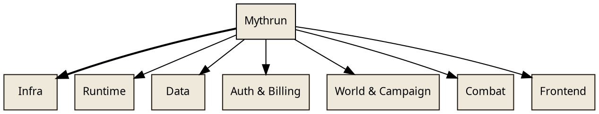

# Wiki Phase 1 — Scaffolding Implementation Plan

> **For agentic workers:** REQUIRED SUB-SKILL: Use superpowers:subagent-driven-development (recommended) or superpowers:executing-plans to implement this plan task-by-task. Steps use checkbox (`- [ ]`) syntax for tracking.

**Goal:** Stand up the internal wiki's build system, layout shell, placeholder content, drift-detection pipeline, and Linear-issue-close hook so that the wiki renders end-to-end and is ready to be populated by Phase 2 (backfill).

**Architecture:** `docs/wiki/` becomes a pnpm workspace package (`@mythrun/wiki`) so it gets `pnpm test` / `typecheck` / `lint` coverage alongside `backend/`. The build is a single TypeScript script (`build.ts`) that composes small utility modules (each TDD'd independently) to stitch content fragments with a shell template, render DOT diagrams to inline SVG via `@hpcc-js/wasm`, and enforce drift detection via per-page source hashes. Output is committed to `docs/wiki/site/` so every page opens directly in a browser via `file://`. A PostToolUse Claude Code hook fires a wiki-update subagent on Linear-issue close.

**Tech Stack:** TypeScript strict (ES2023, NodeNext), `tsx` runtime, Vitest, `@hpcc-js/wasm` (Graphviz → SVG), pnpm workspaces, GitHub Actions.

**Spec:** `docs/superpowers/specs/2026-04-23-internal-wiki-design.md` (committed `cfe62fb`).

---

## File Map

### New files

- `docs/wiki/package.json` — workspace package manifest
- `docs/wiki/tsconfig.json` — per-package TS config (extends a to-be-created root base)
- `docs/wiki/eslint.config.js` — per-package ESLint config (or inherit via root)
- `docs/wiki/structure.ts` — source of truth for nav
- `docs/wiki/build.ts` — main build entry
- `docs/wiki/build/types.ts` — shared types
- `docs/wiki/build/sourceHash.ts` — deterministic source-hash computation
- `docs/wiki/build/extractToc.ts` — parse headings from HTML fragment
- `docs/wiki/build/renderDot.ts` — DOT → SVG via `@hpcc-js/wasm`
- `docs/wiki/build/renderShell.ts` — shell.html slot substitution
- `docs/wiki/build/validate.ts` — content/structure cross-check
- `docs/wiki/build/drift.ts` — drift banner + hash rewrite
- `docs/wiki/build/__tests__/sourceHash.test.ts`
- `docs/wiki/build/__tests__/extractToc.test.ts`
- `docs/wiki/build/__tests__/renderDot.test.ts`
- `docs/wiki/build/__tests__/renderShell.test.ts`
- `docs/wiki/build/__tests__/validate.test.ts`
- `docs/wiki/build/__tests__/drift.test.ts`
- `docs/wiki/build/__tests__/build.test.ts` (integration)
- `docs/wiki/layout/shell.html` — page frame
- `docs/wiki/layout/styles.css` — brand CSS
- `docs/wiki/layout/helper.js` — client-side: TOC scrollspy, active-nav
- `docs/wiki/layout/dot-header.dot` — shared DOT prelude
- `docs/wiki/content/index.html` — landing page
- `docs/wiki/content/infra/index.html` — Infra section placeholder
- `docs/wiki/content/runtime/index.html` — Runtime section placeholder
- `docs/wiki/content/data/index.html` — Data section placeholder
- `docs/wiki/content/auth-billing/index.html` — Auth & Billing section placeholder
- `docs/wiki/content/world-campaign/index.html` — World & Campaign section placeholder
- `docs/wiki/content/combat/index.html` — Combat section placeholder
- `docs/wiki/content/frontend/index.html` — Frontend section placeholder
- `docs/wiki/diagrams/index/wiki-map.dot` — smoke-test landing diagram
- `docs/wiki/site/**/*` — build output (committed)
- `docs/wiki/AUTHORING.md` — authoring guide + subagent prompt template
- `docs/wiki/README.md` — one-pager
- `.claude/hooks/post-linear-close.sh` — hook script
- `.github/workflows/wiki-check.yml` — CI gate

### Modified files

- `pnpm-workspace.yaml` — add `docs/wiki`
- `package.json` — add convenience scripts (`wiki:build`, `wiki:check`, `wiki:accept-drift`)
- `eslint.config.js` — narrow the `docs/**` ignore to exclude `docs/wiki/site/`
- `.prettierignore` — add `docs/wiki/site/` (generated output)
- `CLAUDE.md` — Standard Implementation Workflow addendum + standing rule
- `.claude/settings.json` (may be new) — register the hook

---

## Task 1: Set up `@mythrun/wiki` workspace package

**Goal:** Create the workspace shell so subsequent tasks have a typechecked/testable home.

**Files:**
- Create: `docs/wiki/package.json`
- Create: `docs/wiki/tsconfig.json`
- Create: `docs/wiki/eslint.config.js`
- Modify: `pnpm-workspace.yaml` (add `docs/wiki` to packages)
- Modify: `package.json` (root — add convenience scripts)
- Modify: `eslint.config.js` (root — narrow `docs/**` ignore)
- Modify: `.prettierignore` (create if absent — exclude generated site/)

- [ ] **Step 1: Create `docs/wiki/package.json`**

```json
{
  "name": "@mythrun/wiki",
  "version": "0.0.0",
  "private": true,
  "type": "module",
  "scripts": {
    "build": "tsx build.ts",
    "check": "tsx build.ts --check",
    "accept-drift": "tsx build.ts --accept-drift",
    "test": "vitest run",
    "test:watch": "vitest",
    "lint": "eslint . --no-error-on-unmatched-pattern",
    "typecheck": "tsc --noEmit"
  },
  "dependencies": {
    "@hpcc-js/wasm": "^2.18.0"
  },
  "devDependencies": {
    "@types/node": "^24.0.0",
    "tsx": "^4.19.0",
    "typescript": "^5.6.0",
    "vitest": "^3.0.0"
  }
}
```

- [ ] **Step 2: Create `docs/wiki/tsconfig.json`**

```json
{
  "compilerOptions": {
    "target": "ES2023",
    "module": "NodeNext",
    "moduleResolution": "NodeNext",
    "esModuleInterop": true,
    "skipLibCheck": true,
    "strict": true,
    "noImplicitAny": true,
    "strictNullChecks": true,
    "noUncheckedIndexedAccess": true,
    "exactOptionalPropertyTypes": true,
    "resolveJsonModule": true,
    "forceConsistentCasingInFileNames": true,
    "noEmit": true,
    "allowImportingTsExtensions": true
  },
  "include": ["*.ts", "build/**/*.ts"],
  "exclude": ["site/**", "node_modules/**"]
}
```

- [ ] **Step 3: Create `docs/wiki/eslint.config.js`**

```js
import rootConfig from '../../eslint.config.js'

export default [
  ...rootConfig,
  {
    ignores: ['site/**', 'content/**', 'layout/**', 'diagrams/**', 'assets/**'],
  },
  {
    // describe(...) arrow functions naturally exceed the function-size cap
    // because every it(...) block nests inside them. Scope the waiver to tests.
    files: ['**/__tests__/**/*.ts'],
    rules: {
      'max-lines-per-function': 'off',
    },
  },
]
```

- [ ] **Step 4: Modify `pnpm-workspace.yaml`**

Current content:
```yaml
packages:
  - 'backend'
```

Replace with:
```yaml
packages:
  - 'backend'
  - 'docs/wiki'
```

- [ ] **Step 5: Add root convenience scripts to root `package.json`**

Find the `"scripts"` object in `/Users/miklos/Desktop/Files/Mythrun/Code/mythrun/package.json`. Add these three entries before `"format"`:

```json
    "wiki:build": "pnpm --filter @mythrun/wiki build",
    "wiki:check": "pnpm --filter @mythrun/wiki check",
    "wiki:accept-drift": "pnpm --filter @mythrun/wiki accept-drift",
```

- [ ] **Step 6: Narrow the root `eslint.config.js` docs ignore**

Find the line:
```js
    ignores: ['**/dist/**', '**/node_modules/**', 'docs/**', '.beads/**', '**/*.config.js'],
```

Replace with:
```js
    ignores: ['**/dist/**', '**/node_modules/**', 'docs/wiki/site/**', 'docs/superpowers/**', 'docs/specs/**', '.beads/**', '**/*.config.js'],
```

This removes the blanket `docs/**` ignore so `docs/wiki/build/*.ts` gets linted, while keeping generated site/, specs, and plans out of scope.

- [ ] **Step 7: Create or update `.prettierignore`**

Add a new file at `/Users/miklos/Desktop/Files/Mythrun/Code/mythrun/.prettierignore` (if it doesn't exist) with:

```
**/dist/**
**/node_modules/**
.beads/**
docs/wiki/site/**
```

If the file already exists, append `docs/wiki/site/**` on its own line.

- [ ] **Step 8: Install deps**

Run from repo root: `pnpm install`

Expected: new packages added; `docs/wiki/node_modules/` or hoisted at root; no lockfile errors.

- [ ] **Step 9: Smoke test — typecheck and lint the empty wiki**

```bash
pnpm --filter @mythrun/wiki typecheck
pnpm --filter @mythrun/wiki lint
```

Expected: both exit 0 (nothing to typecheck/lint yet).

- [ ] **Step 10: Commit**

```bash
git add package.json pnpm-workspace.yaml pnpm-lock.yaml eslint.config.js .prettierignore docs/wiki/package.json docs/wiki/tsconfig.json docs/wiki/eslint.config.js
git commit -m "feat(wiki): set up @mythrun/wiki workspace package"
```

---

## Task 2: Types + `structure.ts`

**Goal:** Declare the typed schema and populate the v1 seven-section structure.

**Files:**
- Create: `docs/wiki/build/types.ts`
- Create: `docs/wiki/structure.ts`

- [ ] **Step 1: Create `docs/wiki/build/types.ts`**

Only the three types that cross module boundaries. Build-time internal types (e.g., the flattened per-page record used by the build pipeline) are defined locally in Task 12 — no need to pre-declare them here.

```ts
export interface Page {
  slug: string
  title: string
}

export interface Section {
  slug: string
  title: string
  pages: [Page, ...Page[]]
}

export interface PageMeta {
  sourcePaths: string[]
  sourceHash: string | null
  lastTicket: string | null
}
```

- [ ] **Step 2: Create `docs/wiki/structure.ts`**

Note: **Infra is first** per the spec — AWS/Terraform visualization is the primary value of the wiki.

```ts
import type { Section } from './build/types.ts'

export const structure: Section[] = [
  {
    slug: 'infra',
    title: 'Infra',
    pages: [{ slug: 'index', title: 'Overview' }],
  },
  {
    slug: 'runtime',
    title: 'Runtime',
    pages: [{ slug: 'index', title: 'Overview' }],
  },
  {
    slug: 'data',
    title: 'Data',
    pages: [{ slug: 'index', title: 'Overview' }],
  },
  {
    slug: 'auth-billing',
    title: 'Auth & Billing',
    pages: [{ slug: 'index', title: 'Overview' }],
  },
  {
    slug: 'world-campaign',
    title: 'World & Campaign',
    pages: [{ slug: 'index', title: 'Overview' }],
  },
  {
    slug: 'combat',
    title: 'Combat',
    pages: [{ slug: 'index', title: 'Overview' }],
  },
  {
    slug: 'frontend',
    title: 'Frontend',
    pages: [{ slug: 'index', title: 'Overview' }],
  },
]
```

- [ ] **Step 3: Typecheck**

```bash
pnpm --filter @mythrun/wiki typecheck
```

Expected: exit 0.

- [ ] **Step 4: Commit**

```bash
git add docs/wiki/build/types.ts docs/wiki/structure.ts
git commit -m "feat(wiki): declare types and v1 seven-section structure"
```

---

## Task 3: `sourceHash` utility (TDD)

**Goal:** Deterministic sha256 of a list of tracked source paths.

**Files:**
- Create: `docs/wiki/build/sourceHash.ts`
- Create: `docs/wiki/build/__tests__/sourceHash.test.ts`
- Create: fixture files under `docs/wiki/build/__tests__/fixtures/sourceHash/`

- [ ] **Step 1: Create fixture files**

```bash
mkdir -p docs/wiki/build/__tests__/fixtures/sourceHash/moduleA
printf 'alpha\n' > docs/wiki/build/__tests__/fixtures/sourceHash/moduleA/a.txt
printf 'beta\n' > docs/wiki/build/__tests__/fixtures/sourceHash/moduleA/b.txt
printf 'gamma\n' > docs/wiki/build/__tests__/fixtures/sourceHash/single-file.txt
```

- [ ] **Step 2: Write the failing test**

Create `docs/wiki/build/__tests__/sourceHash.test.ts`:

```ts
import { describe, it, expect } from 'vitest'
import { readFileSync, writeFileSync, symlinkSync, unlinkSync, existsSync } from 'node:fs'
import { resolve, dirname } from 'node:path'
import { fileURLToPath } from 'node:url'
import { computeSourceHash } from '../sourceHash.ts'

const here = dirname(fileURLToPath(import.meta.url))
const fixtureRoot = resolve(here, 'fixtures/sourceHash')

describe('computeSourceHash', () => {
  it('produces a stable 64-char hex digest for a directory', async () => {
    const hash = await computeSourceHash(['moduleA'], fixtureRoot)
    expect(hash).toMatch(/^[0-9a-f]{64}$/)
  })

  it('is deterministic across calls on unchanged input', async () => {
    const a = await computeSourceHash(['moduleA'], fixtureRoot)
    const b = await computeSourceHash(['moduleA'], fixtureRoot)
    expect(a).toBe(b)
  })

  it('changes when a tracked file changes', async () => {
    const before = await computeSourceHash(['moduleA'], fixtureRoot)
    const changed = resolve(fixtureRoot, 'moduleA/a.txt')
    const original = readFileSync(changed, 'utf-8')
    writeFileSync(changed, 'alpha-modified\n')
    try {
      const after = await computeSourceHash(['moduleA'], fixtureRoot)
      expect(after).not.toBe(before)
    } finally {
      writeFileSync(changed, original)
    }
  })

  it('differs for different path lists with same underlying content', async () => {
    const onlyDir = await computeSourceHash(['moduleA'], fixtureRoot)
    const dirAndFile = await computeSourceHash(['moduleA', 'single-file.txt'], fixtureRoot)
    expect(onlyDir).not.toBe(dirAndFile)
  })

  it('throws a clear error if a path does not exist', async () => {
    await expect(computeSourceHash(['nonexistent/path/xyz'], fixtureRoot)).rejects.toThrow(/nonexistent/)
  })

  it('enumerates directory files in a deterministic sorted order', async () => {
    const before = await computeSourceHash(['moduleA'], fixtureRoot)
    const extra = resolve(fixtureRoot, 'moduleA/zz-extra.txt')
    writeFileSync(extra, 'extra\n')
    try {
      const withExtra = await computeSourceHash(['moduleA'], fixtureRoot)
      expect(withExtra).not.toBe(before)
    } finally {
      unlinkSync(extra)
    }
    const restored = await computeSourceHash(['moduleA'], fixtureRoot)
    expect(restored).toBe(before)
  })

  it('is machine-independent: the same relative paths and content produce the same hash regardless of absolute root', async () => {
    // Simulated by computing twice with different root-prefixes onto the same fixture.
    // Achieved by resolving root from two different starting points.
    const viaFixture = await computeSourceHash(['moduleA'], fixtureRoot)
    const viaFixtureAgain = await computeSourceHash(['moduleA'], resolve(fixtureRoot, '.'))
    expect(viaFixtureAgain).toBe(viaFixture)
  })

  it('throws if a tracked directory contains a symlink (rejects symlinks explicitly)', async () => {
    const linkPath = resolve(fixtureRoot, 'moduleA/zz-link.txt')
    const target = resolve(fixtureRoot, 'single-file.txt')
    if (existsSync(linkPath)) unlinkSync(linkPath)
    symlinkSync(target, linkPath)
    try {
      await expect(computeSourceHash(['moduleA'], fixtureRoot)).rejects.toThrow(/symlink/i)
    } finally {
      unlinkSync(linkPath)
    }
  })

  it('throws if a tracked path itself is a symlink', async () => {
    const linkPath = resolve(fixtureRoot, 'zz-link-dir')
    const target = resolve(fixtureRoot, 'moduleA')
    if (existsSync(linkPath)) unlinkSync(linkPath)
    symlinkSync(target, linkPath)
    try {
      await expect(computeSourceHash(['zz-link-dir'], fixtureRoot)).rejects.toThrow(/symlink/i)
    } finally {
      unlinkSync(linkPath)
    }
  })
})
```

- [ ] **Step 3: Run test to verify it fails**

```bash
pnpm --filter @mythrun/wiki test sourceHash
```

Expected: FAIL with "Cannot find module '../sourceHash.ts'".

- [ ] **Step 4: Implement `docs/wiki/build/sourceHash.ts`**

```ts
import { createHash } from 'node:crypto'
import { readFile, lstat, readdir } from 'node:fs/promises'
import { join, relative as relativePath, resolve as resolvePath } from 'node:path'

async function enumerateFiles(absPath: string): Promise<string[]> {
  const stats = await lstat(absPath).catch((err: unknown) => {
    if (err instanceof Error && 'code' in err && err.code === 'ENOENT') {
      throw new Error(`Source path does not exist: ${absPath}`)
    }
    throw err
  })
  if (stats.isSymbolicLink()) {
    throw new Error(`Symlinks are not allowed in tracked source paths: ${absPath}`)
  }
  if (stats.isFile()) return [absPath]
  if (!stats.isDirectory()) return []

  const entries = await readdir(absPath, { withFileTypes: true })
  const nested: string[][] = await Promise.all(
    entries.map(async (entry) => {
      const childAbs = join(absPath, entry.name)
      if (entry.isSymbolicLink()) {
        throw new Error(`Symlinks are not allowed in tracked source paths: ${childAbs}`)
      }
      if (entry.isDirectory()) return enumerateFiles(childAbs)
      if (entry.isFile()) return [childAbs]
      return []
    }),
  )
  return nested.flat()
}

export async function computeSourceHash(paths: string[], root: string): Promise<string> {
  const absoluteRoot = resolvePath(root)
  const absolutePaths = paths.map((p) => resolvePath(absoluteRoot, p))
  const fileLists = await Promise.all(absolutePaths.map((p) => enumerateFiles(p)))
  const allFiles = fileLists.flat().sort()

  // Include the declared path list itself in the digest so that `[dirA]` and
  // `[dirA, fileB]` with identical underlying file contents produce distinct
  // hashes. JSON.stringify avoids any ambiguity in separator handling if a
  // path ever contains a newline.
  const outer = createHash('sha256')
  outer.update(JSON.stringify(paths))
  outer.update('\n---\n')

  for (const file of allFiles) {
    const rel = relativePath(absoluteRoot, file)
    const content = await readFile(file)
    const per = createHash('sha256')
    per.update(rel)
    per.update('\x00')
    per.update(content)
    outer.update(per.digest('hex'))
  }

  return outer.digest('hex')
}
```

- [ ] **Step 5: Run tests**

```bash
pnpm --filter @mythrun/wiki test sourceHash
```

Expected: all tests PASS.

- [ ] **Step 6: Commit**

```bash
git add docs/wiki/build/sourceHash.ts docs/wiki/build/__tests__/sourceHash.test.ts docs/wiki/build/__tests__/fixtures/
git commit -m "feat(wiki): sourceHash utility with deterministic digest"
```

---

## Task 4: `extractToc` utility (TDD)

**Goal:** Parse h2/h3 headings from an HTML fragment into a structured TOC. Generate stable `id` attributes if not present.

**Files:**
- Create: `docs/wiki/build/extractToc.ts`
- Create: `docs/wiki/build/__tests__/extractToc.test.ts`

- [ ] **Step 1: Write the failing test**

```ts
import { describe, it, expect } from 'vitest'
import { extractToc } from '../extractToc.ts'

describe('extractToc', () => {
  it('returns an empty array for content with no h2/h3', () => {
    const { entries, html } = extractToc('<p>Just prose.</p>')
    expect(entries).toEqual([])
    expect(html).toBe('<p>Just prose.</p>')
  })

  it('extracts h2 and h3 with levels, slugifies ids, preserves order', () => {
    const html = '<h2>Inputs</h2><p>x</p><h3>Sub One</h3><h2>Outputs</h2>'
    const { entries } = extractToc(html)
    expect(entries).toEqual([
      { level: 2, id: 'inputs', text: 'Inputs' },
      { level: 3, id: 'sub-one', text: 'Sub One' },
      { level: 2, id: 'outputs', text: 'Outputs' },
    ])
  })

  it('injects id attributes into the rendered html when missing', () => {
    const { html } = extractToc('<h2>Inputs</h2><h3>Sub</h3>')
    expect(html).toContain('<h2 id="inputs">Inputs</h2>')
    expect(html).toContain('<h3 id="sub">Sub</h3>')
  })

  it('preserves a user-provided id attribute and uses it as the toc id', () => {
    const html = '<h2 id="custom-slug">Inputs</h2>'
    const { entries, html: out } = extractToc(html)
    expect(entries).toEqual([{ level: 2, id: 'custom-slug', text: 'Inputs' }])
    expect(out).toBe(html)
  })

  it('slugifies titles with punctuation and multiple spaces', () => {
    const { entries } = extractToc('<h2>Request / Response — Pairs</h2>')
    expect(entries[0]?.id).toBe('request-response-pairs')
  })

  it('disambiguates duplicate slugs with numeric suffixes', () => {
    const { entries } = extractToc('<h2>Inputs</h2><h2>Inputs</h2>')
    expect(entries).toEqual([
      { level: 2, id: 'inputs', text: 'Inputs' },
      { level: 2, id: 'inputs-2', text: 'Inputs' },
    ])
  })

  it('ignores h1 (page title) and h4+ (out-of-toc scope)', () => {
    const { entries } = extractToc('<h1>Page</h1><h2>Keep</h2><h4>Skip</h4>')
    expect(entries).toEqual([{ level: 2, id: 'keep', text: 'Keep' }])
  })

  it('reserves a user-provided id so a later auto-slug disambiguates instead of colliding', () => {
    const { entries } = extractToc('<h2 id="inputs">Manual</h2><h2>Inputs</h2>')
    expect(entries).toEqual([
      { level: 2, id: 'inputs', text: 'Manual' },
      { level: 2, id: 'inputs-2', text: 'Inputs' },
    ])
  })

  it('strips inline tags from the toc text while preserving them in rendered html', () => {
    const { entries, html } = extractToc('<h2>Inputs <code>ft</code></h2>')
    expect(entries[0]?.text).toBe('Inputs ft')
    expect(html).toContain('<code>ft</code>')
  })

  it('preserves non-id attributes on headings when injecting an id', () => {
    const { html } = extractToc('<h2 class="lead">Inputs</h2>')
    expect(html).toContain('class="lead"')
    expect(html).toContain('id="inputs"')
  })

  it('falls back to heading-N when the slug would be empty', () => {
    const { entries } = extractToc('<h2>   </h2><h2>—</h2>')
    expect(entries).toEqual([
      { level: 2, id: 'heading-1', text: '' },
      { level: 2, id: 'heading-2', text: '—' },
    ])
  })
})
```

- [ ] **Step 2: Run test to verify it fails**

```bash
pnpm --filter @mythrun/wiki test extractToc
```

Expected: FAIL with "Cannot find module '../extractToc.ts'".

- [ ] **Step 3: Implement `docs/wiki/build/extractToc.ts`**

```ts
export interface TocEntry {
  level: 2 | 3
  id: string
  text: string
}

export interface ExtractTocResult {
  entries: TocEntry[]
  html: string
}

function slugify(text: string): string {
  return text
    .toLowerCase()
    .replace(/[—–]/g, '-')
    .replace(/[^a-z0-9]+/g, '-')
    .replace(/^-+|-+$/g, '')
}

const headingRegex = /<h([23])(\s[^>]*)?>([\s\S]*?)<\/h\1>/g
const idAttrRegex = /\sid="([^"]+)"/

export function extractToc(fragment: string): ExtractTocResult {
  const entries: TocEntry[] = []
  const seen = new Map<string, number>()

  const html = fragment.replace(headingRegex, (match, levelStr: string, attrs: string | undefined, inner: string) => {
    const level = Number(levelStr) as 2 | 3
    const text = inner.replace(/<[^>]+>/g, '').trim()
    const attrString = attrs ?? ''
    const existingId = idAttrRegex.exec(attrString)?.[1]

    let id: string
    if (existingId !== undefined) {
      id = existingId
      // Reserve the user-declared id so a later auto-slug that collides with
      // it disambiguates rather than emitting a duplicate DOM id.
      seen.set(id, (seen.get(id) ?? 0) + 1)
    } else {
      const base = slugify(text) || `heading-${String(entries.length + 1)}`
      const count = seen.get(base) ?? 0
      id = count === 0 ? base : `${base}-${String(count + 1)}`
      seen.set(base, count + 1)
    }

    entries.push({ level, id, text })

    if (existingId !== undefined) {
      return match
    }
    return `<h${levelStr}${attrString} id="${id}">${inner}</h${levelStr}>`
  })

  return { entries, html }
}
```

- [ ] **Step 4: Run tests**

```bash
pnpm --filter @mythrun/wiki test extractToc
```

Expected: all PASS.

- [ ] **Step 5: Commit**

```bash
git add docs/wiki/build/extractToc.ts docs/wiki/build/__tests__/extractToc.test.ts
git commit -m "feat(wiki): extractToc utility with slug collision handling"
```

---

## Task 5: `renderDot` utility (TDD)

**Goal:** Render a DOT source string to inline SVG via `@hpcc-js/wasm`, prepending the shared brand header and substituting color aliases.

**Files:**
- Create: `docs/wiki/build/renderDot.ts`
- Create: `docs/wiki/build/__tests__/renderDot.test.ts`

- [ ] **Step 1: Write the failing test**

```ts
import { describe, it, expect, beforeAll } from 'vitest'
import { renderDot } from '../renderDot.ts'

describe('renderDot', () => {
  beforeAll(async () => {
    // Warm up the WASM runtime once.
    await renderDot('digraph { a }', '')
  })

  it('returns an SVG string starting with <svg (prolog + DOCTYPE stripped)', async () => {
    const svg = await renderDot('digraph { a -> b }', '')
    expect(svg).toMatch(/^<svg\b/)
    expect(svg).toContain('</svg>')
    expect(svg).not.toContain('<?xml')
    expect(svg).not.toContain('<!DOCTYPE')
  })

  it('prepends the supplied header before the user source inner body', async () => {
    const header = 'graph [bgcolor="#ABCDEF"]'
    const svg = await renderDot('digraph { a -> b }', header)
    // Graphviz lowercases hex literals in its SVG output — match case-insensitively.
    expect(svg).toMatch(/#abcdef/i)
  })

  it('substitutes "ember" color alias with #8A5A3C', async () => {
    const source = 'digraph { a [color="ember"] }'
    const svg = await renderDot(source, '')
    expect(svg).toMatch(/#8a5a3c/i)
    expect(svg).not.toContain('"ember"')
  })

  it('surfaces a readable error when DOT source is malformed', async () => {
    await expect(renderDot('digraph { a ->> b }', '')).rejects.toThrow()
  })

  it('produces stable output for identical input (determinism)', async () => {
    const src = 'digraph { a -> b -> c }'
    const a = await renderDot(src, '')
    const b = await renderDot(src, '')
    expect(a).toBe(b)
  })
})
```

- [ ] **Step 2: Run test to verify it fails**

```bash
pnpm --filter @mythrun/wiki test renderDot
```

Expected: FAIL with "Cannot find module '../renderDot.ts'".

- [ ] **Step 3: Implement `docs/wiki/build/renderDot.ts`**

```ts
// The upstream `@hpcc-js/wasm@2.33.2` ships `types/graphviz.d.ts` as a bare
// `export * from "@hpcc-js/wasm-graphviz"` that re-exports from a sibling
// package which is not listed as a dependency and is not installed. The
// runtime bundle at the `./graphviz` subpath is fine — it exports a
// `Graphviz` namespace with an async `load()` — but TypeScript resolves the
// subpath's types to an empty module. We augment the subpath here with the
// minimal slice of the API that `renderDot` actually uses. This keeps the
// code strictly typed without falling back to `any` or assertions.
declare module '@hpcc-js/wasm/graphviz' {
  export interface GraphvizRenderer {
    dot(source: string, format: 'svg' | 'dot' | 'json'): string
  }
  export const Graphviz: {
    load: () => Promise<GraphvizRenderer>
  }
}

import { Graphviz, type GraphvizRenderer } from '@hpcc-js/wasm/graphviz'

let cached: GraphvizRenderer | null = null

async function getGraphviz(): Promise<GraphvizRenderer> {
  cached ??= await Graphviz.load()
  return cached
}

function substituteAliases(source: string): string {
  // "ember" → ember-600 hex. Done as a whole-word quoted replacement so it
  // doesn't mangle node ids or attribute names.
  return source.replace(/"ember"/g, '"#8A5A3C"')
}

function injectHeader(source: string, header: string): string {
  if (header.length === 0) return source
  // Insert header just after the opening brace of the first graph/digraph block.
  const match = /^(\s*(?:di)?graph\s+[^{]*\{)/s.exec(source)
  if (match === null) {
    throw new Error('renderDot: could not locate opening graph brace to inject header')
  }
  const idx = match.index + match[0].length
  return `${source.slice(0, idx)}\n  ${header}\n${source.slice(idx)}`
}

export async function renderDot(source: string, header: string): Promise<string> {
  const prepared = substituteAliases(injectHeader(source, header))
  const graphviz = await getGraphviz()
  const raw = graphviz.dot(prepared, 'svg')
  // Strip the XML prolog and DOCTYPE — HTML5 parsers treat `<?xml ... ?>` as
  // a bogus comment when inlined, which renders inconsistently across browsers.
  // Return just the <svg>…</svg> slice for safe inline embedding in page bodies.
  const svgStart = raw.indexOf('<svg')
  if (svgStart === -1) {
    throw new Error('renderDot: Graphviz output did not contain an <svg element')
  }
  return raw.slice(svgStart)
}
```

- [ ] **Step 4: Run tests**

```bash
pnpm --filter @mythrun/wiki test renderDot
```

Expected: all PASS. First test may take ~1–2s due to WASM init.

- [ ] **Step 5: Commit**

```bash
git add docs/wiki/build/renderDot.ts docs/wiki/build/__tests__/renderDot.test.ts
git commit -m "feat(wiki): renderDot utility wrapping @hpcc-js/wasm Graphviz"
```

---

## Task 6: `renderShell` utility (TDD)

**Goal:** Substitute `<!-- @slot -->` markers in a shell template with provided values.

**Files:**
- Create: `docs/wiki/build/renderShell.ts`
- Create: `docs/wiki/build/__tests__/renderShell.test.ts`

- [ ] **Step 1: Write the failing test**

```ts
import { describe, it, expect } from 'vitest'
import { renderShell } from '../renderShell.ts'

describe('renderShell', () => {
  it('substitutes a single slot marker', () => {
    const shell = '<title><!-- @pageTitle --></title>'
    const out = renderShell(shell, { pageTitle: 'Fast Thinker' })
    expect(out).toBe('<title>Fast Thinker</title>')
  })

  it('substitutes multiple distinct slots', () => {
    const shell = '<h1><!-- @title --></h1><aside><!-- @sidebar --></aside>'
    const out = renderShell(shell, { title: 'X', sidebar: '<ul></ul>' })
    expect(out).toBe('<h1>X</h1><aside><ul></ul></aside>')
  })

  it('substitutes repeated occurrences of the same slot', () => {
    const shell = '<!-- @x --> and <!-- @x -->'
    const out = renderShell(shell, { x: 'hi' })
    expect(out).toBe('hi and hi')
  })

  it('throws when a marker is present but unprovided', () => {
    const shell = '<!-- @missing -->'
    expect(() => renderShell(shell, {})).toThrow(/missing/)
  })

  it('throws when an unknown slot is provided (typo guard)', () => {
    const shell = '<h1><!-- @title --></h1>'
    expect(() => renderShell(shell, { title: 'X', titel: 'Y' })).toThrow(/titel/)
  })

  it('treats empty string as a valid substitution (does not throw)', () => {
    const shell = '[<!-- @maybe -->]'
    const out = renderShell(shell, { maybe: '' })
    expect(out).toBe('[]')
  })
})
```

- [ ] **Step 2: Run test to verify it fails**

```bash
pnpm --filter @mythrun/wiki test renderShell
```

Expected: FAIL with "Cannot find module '../renderShell.ts'".

- [ ] **Step 3: Implement `docs/wiki/build/renderShell.ts`**

```ts
const slotRegex = /<!--\s*@(\w+)\s*-->/g

export function renderShell(shell: string, slots: Record<string, string>): string {
  const required = new Set<string>()
  let scanMatch: RegExpExecArray | null
  const scanRegex = /<!--\s*@(\w+)\s*-->/g
  while ((scanMatch = scanRegex.exec(shell)) !== null) {
    required.add(scanMatch[1]!)
  }

  for (const slot of required) {
    if (!(slot in slots)) {
      throw new Error(`renderShell: missing slot "${slot}" in provided values`)
    }
  }
  for (const key of Object.keys(slots)) {
    if (!required.has(key)) {
      throw new Error(`renderShell: unknown slot "${key}" — no <!-- @${key} --> marker in shell`)
    }
  }

  return shell.replace(slotRegex, (_full, name: string) => slots[name] ?? '')
}
```

- [ ] **Step 4: Run tests**

```bash
pnpm --filter @mythrun/wiki test renderShell
```

Expected: all PASS.

- [ ] **Step 5: Commit**

```bash
git add docs/wiki/build/renderShell.ts docs/wiki/build/__tests__/renderShell.test.ts
git commit -m "feat(wiki): renderShell utility with slot validation"
```

---

## Task 7: Content/structure validator (TDD)

**Goal:** Cross-check that every entry in `structure.ts` has a matching content file, and that there are no orphan content files not declared in the structure.

**Files:**
- Create: `docs/wiki/build/validate.ts`
- Create: `docs/wiki/build/__tests__/validate.test.ts`
- Create: fixture content dir under `docs/wiki/build/__tests__/fixtures/validate/`

- [ ] **Step 1: Create fixture content dirs**

```bash
mkdir -p docs/wiki/build/__tests__/fixtures/validate/ok/infra
touch docs/wiki/build/__tests__/fixtures/validate/ok/index.html
touch docs/wiki/build/__tests__/fixtures/validate/ok/infra/index.html

mkdir -p docs/wiki/build/__tests__/fixtures/validate/missing-file/infra
touch docs/wiki/build/__tests__/fixtures/validate/missing-file/index.html
# no infra/index.html — structure declares it but file absent

mkdir -p docs/wiki/build/__tests__/fixtures/validate/orphan/infra
touch docs/wiki/build/__tests__/fixtures/validate/orphan/index.html
touch docs/wiki/build/__tests__/fixtures/validate/orphan/infra/index.html
mkdir -p docs/wiki/build/__tests__/fixtures/validate/orphan/runtime
touch docs/wiki/build/__tests__/fixtures/validate/orphan/runtime/index.html
# runtime/index.html not in the fixture's structure — orphan
```

- [ ] **Step 2: Write the failing test**

```ts
import { describe, it, expect } from 'vitest'
import { resolve, dirname } from 'node:path'
import { fileURLToPath } from 'node:url'
import { validateStructure } from '../validate.ts'
import type { Section } from '../types.ts'

const here = dirname(fileURLToPath(import.meta.url))
const structure: Section[] = [
  { slug: 'infra', title: 'Infra', pages: [{ slug: 'index', title: 'Overview' }] },
]

describe('validateStructure', () => {
  it('returns no errors when content tree matches structure exactly', async () => {
    const result = await validateStructure(structure, resolve(here, 'fixtures/validate/ok'))
    expect(result.errors).toEqual([])
  })

  it('reports a missing content file declared in structure', async () => {
    const result = await validateStructure(structure, resolve(here, 'fixtures/validate/missing-file'))
    expect(result.errors).toHaveLength(1)
    expect(result.errors[0]).toMatch(/infra\/index\.html.*missing/i)
  })

  it('reports an orphan content file not declared in structure', async () => {
    const result = await validateStructure(structure, resolve(here, 'fixtures/validate/orphan'))
    expect(result.errors).toHaveLength(1)
    expect(result.errors[0]).toMatch(/runtime\/index\.html.*orphan/i)
  })

  it('catches duplicate section slugs across structure entries', async () => {
    const dupStructure: Section[] = [
      { slug: 'infra', title: 'Infra', pages: [{ slug: 'index', title: 'Overview' }] },
      { slug: 'infra', title: 'Other', pages: [{ slug: 'index', title: 'Overview' }] },
    ]
    const result = await validateStructure(dupStructure, resolve(here, 'fixtures/validate/ok'))
    expect(result.errors.some((e) => /duplicate.*infra/i.test(e))).toBe(true)
  })

  it('catches duplicate page slugs within a section', async () => {
    const dupStructure: Section[] = [
      {
        slug: 'infra',
        title: 'Infra',
        pages: [
          { slug: 'index', title: 'A' },
          { slug: 'index', title: 'B' },
        ],
      },
    ]
    const result = await validateStructure(dupStructure, resolve(here, 'fixtures/validate/ok'))
    expect(result.errors.some((e) => /duplicate.*index.*infra/i.test(e))).toBe(true)
  })

  it('requires the first page of every section to have slug "index"', async () => {
    const badStructure: Section[] = [
      { slug: 'infra', title: 'Infra', pages: [{ slug: 'overview', title: 'Overview' }] },
    ]
    const result = await validateStructure(badStructure, resolve(here, 'fixtures/validate/ok'))
    expect(result.errors.some((e) => /first page.*index/i.test(e))).toBe(true)
  })
})
```

- [ ] **Step 3: Run test to verify it fails**

```bash
pnpm --filter @mythrun/wiki test validate
```

Expected: FAIL with "Cannot find module '../validate.ts'".

- [ ] **Step 4: Implement `docs/wiki/build/validate.ts`**

```ts
import { readdir, stat } from 'node:fs/promises'
import { join, relative } from 'node:path'
import type { Section } from './types.ts'

export interface ValidateResult {
  errors: string[]
}

async function enumerateHtmlFiles(dir: string, base = dir): Promise<string[]> {
  const entries = await readdir(dir, { withFileTypes: true }).catch(() => [])
  const nested: string[][] = await Promise.all(
    entries.map(async (entry) => {
      const abs = join(dir, entry.name)
      if (entry.isDirectory()) return enumerateHtmlFiles(abs, base)
      if (entry.isFile() && entry.name.endsWith('.html')) {
        return [relative(base, abs)]
      }
      return []
    }),
  )
  return nested.flat().sort()
}

export async function validateStructure(
  structure: Section[],
  contentDir: string,
): Promise<ValidateResult> {
  const errors: string[] = []

  const seenSectionSlugs = new Set<string>()
  for (const section of structure) {
    if (seenSectionSlugs.has(section.slug)) {
      errors.push(`duplicate section slug "${section.slug}" in structure`)
    }
    seenSectionSlugs.add(section.slug)

    if (section.pages[0]?.slug !== 'index') {
      errors.push(`first page of section "${section.slug}" must have slug "index"`)
    }

    const seenPageSlugs = new Set<string>()
    for (const page of section.pages) {
      if (seenPageSlugs.has(page.slug)) {
        errors.push(`duplicate page slug "${page.slug}" in section "${section.slug}"`)
      }
      seenPageSlugs.add(page.slug)
    }
  }

  const declared = new Set<string>()
  declared.add('index.html')
  for (const section of structure) {
    for (const page of section.pages) {
      declared.add(`${section.slug}/${page.slug}.html`)
    }
  }

  const actual = new Set(await enumerateHtmlFiles(contentDir))

  for (const relPath of declared) {
    if (!actual.has(relPath)) {
      const exists = await stat(join(contentDir, relPath))
        .then(() => true)
        .catch(() => false)
      if (!exists) {
        errors.push(`content file ${relPath} is missing (declared in structure)`)
      }
    }
  }

  for (const relPath of actual) {
    if (!declared.has(relPath)) {
      errors.push(`content file ${relPath} is orphan (not in structure)`)
    }
  }

  return { errors }
}
```

- [ ] **Step 5: Add landing-page exemption to test and impl**

The landing page `content/index.html` has no corresponding structure entry (it's the root landing, not part of any section). In step 4, `declared.add('index.html')` handles this. Update the `ok/index.html` fixture expectation in test case 1 to include it as declared (already done in impl).

Verify the first test case still passes with this handling — `ok/` has both `index.html` and `infra/index.html`, structure only declares `infra/index.html`, and we auto-declare `index.html`. Good.

- [ ] **Step 6: Run tests**

```bash
pnpm --filter @mythrun/wiki test validate
```

Expected: all PASS.

- [ ] **Step 7: Commit**

```bash
git add docs/wiki/build/validate.ts docs/wiki/build/__tests__/validate.test.ts docs/wiki/build/__tests__/fixtures/validate/
git commit -m "feat(wiki): content/structure validator"
```

---

## Task 8: Drift detection utility (TDD)

**Goal:** Parse per-page source comments, compute current hash, report drift, render drift banner, rewrite hash on accept.

**Files:**
- Create: `docs/wiki/build/drift.ts`
- Create: `docs/wiki/build/__tests__/drift.test.ts`
- Create: fixture HTML files under `docs/wiki/build/__tests__/fixtures/drift/`

- [ ] **Step 1: Create fixture files**

```bash
mkdir -p docs/wiki/build/__tests__/fixtures/drift/sources/moduleA
printf 'alpha\n' > docs/wiki/build/__tests__/fixtures/drift/sources/moduleA/a.txt

cat > docs/wiki/build/__tests__/fixtures/drift/with-source.html << 'EOF'
<!-- source: docs/wiki/build/__tests__/fixtures/drift/sources/moduleA -->
<!-- source-hash: sha256:deadbeef -->
<h1>Page</h1>
<p>content</p>
EOF

cat > docs/wiki/build/__tests__/fixtures/drift/no-source.html << 'EOF'
<h1>Page</h1>
<p>content</p>
EOF

cat > docs/wiki/build/__tests__/fixtures/drift/new-page.html << 'EOF'
<!-- source: docs/wiki/build/__tests__/fixtures/drift/sources/moduleA -->
<h1>Page</h1>
<p>content</p>
EOF
```

- [ ] **Step 2: Write the failing test**

```ts
import { describe, it, expect } from 'vitest'
import { readFileSync } from 'node:fs'
import { resolve, dirname } from 'node:path'
import { fileURLToPath } from 'node:url'
import { parsePageMeta, checkDrift, renderDriftBanner, rewriteSourceHash } from '../drift.ts'

const here = dirname(fileURLToPath(import.meta.url))
const withSource = resolve(here, 'fixtures/drift/with-source.html')
const noSource = resolve(here, 'fixtures/drift/no-source.html')
const newPage = resolve(here, 'fixtures/drift/new-page.html')

describe('parsePageMeta', () => {
  it('returns empty meta for a page with no source comments', () => {
    const content = readFileSync(noSource, 'utf-8')
    const meta = parsePageMeta(content)
    expect(meta.sourcePaths).toEqual([])
    expect(meta.sourceHash).toBeNull()
  })

  it('extracts source paths and source-hash', () => {
    const content = readFileSync(withSource, 'utf-8')
    const meta = parsePageMeta(content)
    expect(meta.sourcePaths).toHaveLength(1)
    expect(meta.sourcePaths[0]).toContain('moduleA')
    expect(meta.sourceHash).toBe('sha256:deadbeef')
  })

  it('returns null source-hash when source is declared but no hash is present', () => {
    const content = readFileSync(newPage, 'utf-8')
    const meta = parsePageMeta(content)
    expect(meta.sourcePaths).toHaveLength(1)
    expect(meta.sourceHash).toBeNull()
  })

  it('captures multiple source paths', () => {
    const content = '<!-- source: a/b -->\n<!-- source: c/d -->\n'
    const meta = parsePageMeta(content)
    expect(meta.sourcePaths).toEqual(['a/b', 'c/d'])
  })
})

describe('checkDrift', () => {
  it('returns match=true when embedded hash equals current hash', () => {
    const result = checkDrift({ sourceHash: 'sha256:abc', sourcePaths: ['x'], lastTicket: null }, 'sha256:abc')
    expect(result).toEqual({ drifted: false, status: 'match' })
  })

  it('returns drifted=true with status=mismatch when hashes differ', () => {
    const result = checkDrift({ sourceHash: 'sha256:abc', sourcePaths: ['x'], lastTicket: null }, 'sha256:xyz')
    expect(result).toEqual({ drifted: true, status: 'mismatch' })
  })

  it('returns drifted=true with status=new when source is declared but hash is absent', () => {
    const result = checkDrift({ sourceHash: null, sourcePaths: ['x'], lastTicket: null }, 'sha256:xyz')
    expect(result).toEqual({ drifted: true, status: 'new' })
  })

  it('returns match when page declares no source and has no current hash', () => {
    const result = checkDrift({ sourceHash: null, sourcePaths: [], lastTicket: null }, null)
    expect(result).toEqual({ drifted: false, status: 'sourceless' })
  })
})

describe('renderDriftBanner', () => {
  it('renders a banner containing the source paths and the word drifted', () => {
    const html = renderDriftBanner(['infra/modules/network/', 'infra/modules/data/'])
    expect(html).toContain('drifted')
    expect(html).toContain('infra/modules/network/')
    expect(html).toContain('infra/modules/data/')
    expect(html).toContain('wiki-drift-banner')
  })
})

describe('rewriteSourceHash', () => {
  it('replaces an existing source-hash comment', () => {
    const input = '<!-- source: x -->\n<!-- source-hash: sha256:old -->\n<h1>hi</h1>'
    const out = rewriteSourceHash(input, 'sha256:new')
    expect(out).toContain('<!-- source-hash: sha256:new -->')
    expect(out).not.toContain('sha256:old')
  })

  it('inserts a source-hash comment after the last source comment when none exists', () => {
    const input = '<!-- source: x -->\n<!-- source: y -->\n<h1>hi</h1>'
    const out = rewriteSourceHash(input, 'sha256:new')
    expect(out).toContain('<!-- source-hash: sha256:new -->')
    // Inserted after the last <!-- source: -->, before the <h1>
    expect(out.indexOf('<!-- source: y -->')).toBeLessThan(out.indexOf('<!-- source-hash:'))
    expect(out.indexOf('<!-- source-hash:')).toBeLessThan(out.indexOf('<h1>'))
  })

  it('throws when attempting to rewrite a page with no source declarations', () => {
    const input = '<h1>hi</h1>'
    expect(() => rewriteSourceHash(input, 'sha256:new')).toThrow(/no source/i)
  })
})
```

- [ ] **Step 3: Run test to verify it fails**

```bash
pnpm --filter @mythrun/wiki test drift
```

Expected: FAIL with "Cannot find module '../drift.ts'".

- [ ] **Step 4: Implement `docs/wiki/build/drift.ts`**

```ts
import type { PageMeta } from './types.ts'

const sourceRegex = /<!--\s*source:\s*([^\n-][^\n]*?)\s*-->/g
const sourceHashRegex = /<!--\s*source-hash:\s*(sha256:[0-9a-f]+)\s*-->/
const lastTicketRegex = /<!--\s*last-ticket:\s*([A-Z]+-\d+)\s*-->/

export function parsePageMeta(content: string): PageMeta {
  const sourcePaths: string[] = []
  let match: RegExpExecArray | null
  const re = /<!--\s*source:\s*([^\n-][^\n]*?)\s*-->/g
  while ((match = re.exec(content)) !== null) {
    sourcePaths.push(match[1]!)
  }
  const hashMatch = sourceHashRegex.exec(content)
  const ticketMatch = lastTicketRegex.exec(content)
  return {
    sourcePaths,
    sourceHash: hashMatch?.[1] ?? null,
    lastTicket: ticketMatch?.[1] ?? null,
  }
}

export type DriftStatus = 'match' | 'mismatch' | 'new' | 'sourceless'

export interface DriftResult {
  drifted: boolean
  status: DriftStatus
}

export function checkDrift(meta: PageMeta, currentHash: string | null): DriftResult {
  if (meta.sourcePaths.length === 0) {
    return { drifted: false, status: 'sourceless' }
  }
  if (meta.sourceHash === null) {
    return { drifted: true, status: 'new' }
  }
  if (meta.sourceHash === currentHash) {
    return { drifted: false, status: 'match' }
  }
  return { drifted: true, status: 'mismatch' }
}

export function renderDriftBanner(sourcePaths: string[]): string {
  const pathList = sourcePaths.map((p) => `<code>${p}</code>`).join(', ')
  return [
    '<div class="wiki-drift-banner" role="alert">',
    '  <strong>⚠️ Source has drifted.</strong>',
    '  <span>The source files this page documents have changed since the page was last updated. Verify before trusting.</span>',
    `  <div class="wiki-drift-paths">source: ${pathList}</div>`,
    '</div>',
  ].join('\n')
}

export function rewriteSourceHash(content: string, newHash: string): string {
  if (!sourceRegex.test(content)) {
    sourceRegex.lastIndex = 0
    throw new Error('rewriteSourceHash: page has no source declarations')
  }
  sourceRegex.lastIndex = 0

  if (sourceHashRegex.test(content)) {
    return content.replace(sourceHashRegex, `<!-- source-hash: ${newHash} -->`)
  }

  // Insert after the last <!-- source: --> comment.
  let lastEnd = -1
  let m: RegExpExecArray | null
  const re = /<!--\s*source:[^\n]*-->/g
  while ((m = re.exec(content)) !== null) {
    lastEnd = m.index + m[0].length
  }
  if (lastEnd === -1) {
    throw new Error('rewriteSourceHash: could not find source comment boundary')
  }
  const insertion = `\n<!-- source-hash: ${newHash} -->`
  return content.slice(0, lastEnd) + insertion + content.slice(lastEnd)
}
```

- [ ] **Step 5: Run tests**

```bash
pnpm --filter @mythrun/wiki test drift
```

Expected: all PASS.

- [ ] **Step 6: Commit**

```bash
git add docs/wiki/build/drift.ts docs/wiki/build/__tests__/drift.test.ts docs/wiki/build/__tests__/fixtures/drift/
git commit -m "feat(wiki): drift detection utilities"
```

---

## Task 9: Layout files (shell, styles, helper.js, dot-header)

**Goal:** Author the static layout assets that drive every rendered page. No TDD — these are static artifacts verified end-to-end by Task 13's integration build.

**Files:**
- Create: `docs/wiki/layout/shell.html`
- Create: `docs/wiki/layout/styles.css`
- Create: `docs/wiki/layout/helper.js`
- Create: `docs/wiki/layout/dot-header.dot`

- [ ] **Step 1: Create `docs/wiki/layout/shell.html`**

```html
<!DOCTYPE html>
<html lang="en">
<head>
  <meta charset="UTF-8">
  <meta name="viewport" content="width=device-width, initial-scale=1">
  <title><!-- @pageTitle --> · Mythrun Wiki</title>
  <link rel="icon" type="image/svg+xml" href="<!-- @rootPath -->assets/favicon.svg">
  <link rel="preconnect" href="https://fonts.googleapis.com">
  <link rel="preconnect" href="https://fonts.gstatic.com" crossorigin>
  <link href="https://fonts.googleapis.com/css2?family=Source+Serif+4:ital,opsz,wght@0,8..60,300..900;1,8..60,300..900&family=IBM+Plex+Mono:wght@400;500;600&display=swap" rel="stylesheet">
  <link rel="stylesheet" href="<!-- @rootPath -->styles.css">
</head>
<body data-section="<!-- @sectionSlug -->" data-page="<!-- @pageSlug -->">
  <header class="wiki-header">
    <a href="<!-- @rootPath -->index.html" class="wiki-lockup">
      assets/lockup-horizontal-primary.svg" alt="Mythrun">
      <span class="wiki-label">wiki</span>
    </a>
    <nav class="wiki-topnav"><!-- @topnav --></nav>
  </header>
  <div class="wiki-shell">
    <aside class="wiki-sidebar"><!-- @sidebar --></aside>
    <main class="wiki-content">
      <div class="wiki-crumbs"><!-- @crumbs --></div>
      <article><!-- @content --></article>
      <footer class="wiki-page-footer"><!-- @lastUpdated --></footer>
    </main>
    <aside class="wiki-toc">
      <div class="wiki-toc-label">On this page</div>
      <!-- @toc -->
    </aside>
  </div>
  <script src="<!-- @rootPath -->helper.js"></script>
</body>
</html>
```

- [ ] **Step 2: Create `docs/wiki/layout/styles.css`**

```css
:root {
  --paper-100: #EFE9DC;
  --paper-300: #C9C0AD;
  --paper-500: #877F72;
  --paper-700: #3D3528;
  --paper-900: #231B12;
  --ember-600: #8A5A3C;
  --danger-500: #B55A48;
  --serif: 'Source Serif 4', Georgia, serif;
  --mono: 'IBM Plex Mono', ui-monospace, monospace;
}

* { box-sizing: border-box; }

html, body {
  margin: 0; padding: 0;
  background: var(--paper-100);
  color: var(--paper-900);
  font-family: var(--serif);
  font-size: 17px;
  line-height: 1.6;
}

.wiki-header {
  display: flex; align-items: center; justify-content: space-between;
  padding: 12px 32px;
  border-bottom: 1px solid var(--paper-300);
  background: var(--paper-100);
  position: sticky; top: 0; z-index: 10;
}
.wiki-lockup { display: flex; align-items: center; gap: 10px; text-decoration: none; color: inherit; }
.wiki-lockup img { height: 24px; }
.wiki-label {
  font-family: var(--mono); font-size: 12px; letter-spacing: 2px;
  color: var(--paper-500); text-transform: uppercase;
  border-left: 1px solid var(--paper-300); padding-left: 10px;
}
.wiki-topnav { display: flex; gap: 20px; font-family: var(--mono); font-size: 13px; }
.wiki-topnav a {
  color: var(--paper-700); text-decoration: none; padding-bottom: 4px;
  border-bottom: 1px solid transparent;
}
.wiki-topnav a.active { color: var(--ember-600); border-bottom-color: var(--ember-600); }
.wiki-topnav a:hover { color: var(--paper-900); }

.wiki-shell {
  display: grid;
  grid-template-columns: 240px 1fr 220px;
  gap: 0;
  min-height: calc(100vh - 60px);
}

.wiki-sidebar, .wiki-toc {
  padding: 24px 20px;
  font-family: var(--mono); font-size: 13px;
  border-right: 1px solid var(--paper-300);
  background: var(--paper-100);
}
.wiki-toc { border-right: none; border-left: 1px solid var(--paper-300); }

.wiki-sidebar ul, .wiki-toc ul { list-style: none; padding: 0; margin: 0; }
.wiki-sidebar li, .wiki-toc li { padding: 4px 0; line-height: 1.5; }
.wiki-sidebar a, .wiki-toc a {
  color: var(--paper-700); text-decoration: none;
  display: block; padding-left: 8px;
  border-left: 2px solid transparent;
}
.wiki-sidebar a.active, .wiki-toc a.active {
  color: var(--ember-600); border-left-color: var(--ember-600);
}
.wiki-sidebar a:hover, .wiki-toc a:hover { color: var(--paper-900); }

.wiki-toc-label {
  font-family: var(--mono); font-size: 10px; letter-spacing: 1px;
  text-transform: uppercase; color: var(--paper-500); margin-bottom: 8px;
}

.wiki-content { padding: 32px 48px; max-width: 760px; }
.wiki-crumbs {
  font-family: var(--mono); font-size: 12px; color: var(--paper-500);
  margin-bottom: 16px;
}
.wiki-crumbs a { color: var(--paper-700); text-decoration: none; }
.wiki-crumbs a:hover { color: var(--ember-600); }

article h1 { font-size: 34px; font-weight: 500; margin: 0 0 16px 0; line-height: 1.2; }
article h2 { font-size: 24px; font-weight: 500; margin: 32px 0 12px 0; line-height: 1.3; }
article h3 { font-size: 19px; font-weight: 600; margin: 24px 0 8px 0; line-height: 1.4; }
article p { margin: 0 0 14px 0; color: var(--paper-700); }
article p.lead { font-size: 19px; color: var(--paper-900); margin-bottom: 20px; }

article code {
  font-family: var(--mono); font-size: 0.92em;
  background: rgba(137, 90, 60, 0.08); padding: 1px 5px; border-radius: 2px;
}
article pre {
  font-family: var(--mono); background: rgba(35, 27, 18, 0.04);
  border: 1px solid var(--paper-300); padding: 12px 14px; overflow-x: auto;
  font-size: 13px; line-height: 1.5;
}
article pre code { background: none; padding: 0; }

article a { color: var(--ember-600); text-decoration: underline; text-decoration-thickness: 1px; text-underline-offset: 2px; }
article a:hover { color: var(--paper-900); }

article svg { max-width: 100%; height: auto; display: block; margin: 16px 0; }

.wiki-drift-banner {
  background: var(--paper-100);
  border-left: 4px solid var(--danger-500);
  padding: 14px 18px; margin: 0 0 20px 0;
  font-family: var(--mono); font-size: 13px; line-height: 1.5;
}
.wiki-drift-banner strong { color: var(--paper-900); margin-right: 8px; }
.wiki-drift-banner .wiki-drift-paths { color: var(--paper-500); margin-top: 6px; font-size: 12px; }
.wiki-drift-banner code {
  background: rgba(181, 90, 72, 0.08); padding: 1px 4px; font-size: 12px;
}

.wiki-page-footer {
  margin-top: 48px; padding-top: 16px;
  border-top: 1px solid var(--paper-300);
  font-family: var(--mono); font-size: 11px; color: var(--paper-500);
}
```

- [ ] **Step 3: Create `docs/wiki/layout/helper.js`**

```js
// Client-side: TOC scrollspy and mild active-nav fallback.
// No frameworks. No build step. Plain ES module, loaded via <script src=...>.

(function () {
  'use strict';

  function setActiveToc() {
    var tocLinks = document.querySelectorAll('.wiki-toc a[href^="#"]');
    if (tocLinks.length === 0) return;

    var targets = [];
    tocLinks.forEach(function (a) {
      var id = a.getAttribute('href').slice(1);
      var el = document.getElementById(id);
      if (el !== null) targets.push({ id: id, el: el, link: a });
    });

    var observer = new IntersectionObserver(
      function (entries) {
        entries.forEach(function (entry) {
          if (entry.isIntersecting) {
            tocLinks.forEach(function (l) { l.classList.remove('active'); });
            var match = targets.find(function (t) { return t.el === entry.target; });
            if (match !== undefined) match.link.classList.add('active');
          }
        });
      },
      { rootMargin: '-20% 0% -70% 0%', threshold: 0 },
    );

    targets.forEach(function (t) { observer.observe(t.el); });
  }

  if (document.readyState === 'loading') {
    document.addEventListener('DOMContentLoaded', setActiveToc);
  } else {
    setActiveToc();
  }
})();
```

- [ ] **Step 4: Create `docs/wiki/layout/dot-header.dot`**

```dot
graph [
  bgcolor="#EFE9DC",
  fontname="IBM Plex Mono",
  fontsize=11,
  rankdir=LR,
  margin=0.2,
]
node [
  shape=box,
  style="filled",
  fillcolor="#EFE9DC",
  color="#231B12",
  fontcolor="#231B12",
  fontname="IBM Plex Mono",
  fontsize=11,
  penwidth=1.5,
]
edge [
  color="#231B12",
  fontname="IBM Plex Mono",
  fontsize=10,
  penwidth=1.2,
  arrowsize=0.7,
]
```

- [ ] **Step 5: Commit**

```bash
git add docs/wiki/layout/
git commit -m "feat(wiki): layout files — shell, styles, helper.js, dot-header"
```

---

## Task 10: Content files (landing + 7 section placeholders)

**Goal:** Author the v1 content tree.

**Files:**
- Create: `docs/wiki/content/index.html`
- Create: `docs/wiki/content/infra/index.html`
- Create: `docs/wiki/content/runtime/index.html`
- Create: `docs/wiki/content/data/index.html`
- Create: `docs/wiki/content/auth-billing/index.html`
- Create: `docs/wiki/content/world-campaign/index.html`
- Create: `docs/wiki/content/combat/index.html`
- Create: `docs/wiki/content/frontend/index.html`

- [ ] **Step 1: Create `docs/wiki/content/index.html`** (landing)

```html
<h1>Mythrun Wiki</h1>

<p class="lead">
  An agent-maintained, as-built view of the whole Mythrun system — both the
  application code and the AWS infrastructure. Diagrammed, cross-linked, and
  updated alongside every Linear issue that ships.
</p>

<!-- @diagram: index/wiki-map -->

<h2>Sections</h2>

<p>
  The wiki is organized into seven sections. <strong>Infra</strong> comes
  first because AWS resources are inherently harder to hold in your head
  than code; visualizing them cleanly is the highest-leverage payoff.
</p>

<ul>
  <li><a href="infra/index.html">Infra</a> — AWS topology, Terraform modules, environments, networking, compute, data plane, DNS, secrets, CI/CD, observability.</li>
  <li><a href="runtime/index.html">Runtime</a> — session loop, Fast Thinker, Slow Thinker, Scribe, DM Trigger, prompts, Anthropic integration.</li>
  <li><a href="data/index.html">Data</a> — schemas, repositories, Postgres, Redis, BullMQ.</li>
  <li><a href="auth-billing/index.html">Auth &amp; Billing</a> — Cognito, JWT, invites, Stripe, credits.</li>
  <li><a href="world-campaign/index.html">World &amp; Campaign</a> — prep engine, world store, campaign pipeline.</li>
  <li><a href="combat/index.html">Combat</a> — rules engine, voxel maps, map rendering.</li>
  <li><a href="frontend/index.html">Frontend</a> — components, Three.js layer, design system adapters.</li>
</ul>

<h2>How this is maintained</h2>

<p>
  Every section page declares which source files (code paths, Terraform
  directories) it documents. On each build, the wiki computes a hash of
  those sources and compares it to the hash captured at the page's last
  update. Mismatches render a visible drift banner on the page and fail
  <code>pnpm wiki:check</code> in CI, so pages can't silently go stale.
</p>
```

- [ ] **Step 2: Create `docs/wiki/content/infra/index.html`**

```html
<h1>Infra</h1>

<p class="lead">
  Mythrun's AWS infrastructure: accounts, environments, Terraform modules,
  networking, compute, data plane, DNS, secrets, CI/CD, observability.
</p>

<p>
  Nothing built here yet. This section will be populated in Phase 2 of
  the wiki rollout, pulling from <code>infra/</code> in the repo. Expect
  pages covering the <code>network</code>, <code>data</code>,
  <code>serving</code>, and <code>dns</code> modules, each with a DOT
  diagram of the AWS resources it creates, plus environment pages
  (<code>shared</code>, <code>staging</code>) showing how those modules
  compose.
</p>
```

- [ ] **Step 3: Create the remaining six section placeholders**

Each follows the same pattern. Create these files with the content shown:

`docs/wiki/content/runtime/index.html`:
```html
<h1>Runtime</h1>
<p class="lead">Cognitive tiers, session loop, prompts, Anthropic integration.</p>
<p>Nothing built here yet. Will be populated as runtime components ship.</p>
```

`docs/wiki/content/data/index.html`:
```html
<h1>Data</h1>
<p class="lead">Schemas, repositories, Postgres, Redis, BullMQ.</p>
<p>Nothing built here yet. Will be populated as data-layer components ship.</p>
```

`docs/wiki/content/auth-billing/index.html`:
```html
<h1>Auth &amp; Billing</h1>
<p class="lead">Cognito integration, JWT handling, invites, Stripe, credits.</p>
<p>Nothing built here yet. Will be populated as auth and billing ship.</p>
```

`docs/wiki/content/world-campaign/index.html`:
```html
<h1>World &amp; Campaign</h1>
<p class="lead">Prep engine, world store, campaign pipeline.</p>
<p>Nothing built here yet. Will be populated as the world/campaign pipeline ships.</p>
```

`docs/wiki/content/combat/index.html`:
```html
<h1>Combat</h1>
<p class="lead">Rules engine, voxel maps, map rendering.</p>
<p>Nothing built here yet. Will be populated as the combat engine ships.</p>
```

`docs/wiki/content/frontend/index.html`:
```html
<h1>Frontend</h1>
<p class="lead">Components, Three.js layer, design system adapters.</p>
<p>Nothing built here yet. Will be populated as the frontend ships.</p>
```

- [ ] **Step 4: Commit**

```bash
git add docs/wiki/content/
git commit -m "feat(wiki): v1 content — landing + seven section placeholders"
```

---

## Task 11: Landing-page DOT diagram (wiki map)

**Goal:** Create the "map of the wiki" DOT that proves the diagram pipeline renders on-brand end-to-end.

**Files:**
- Create: `docs/wiki/diagrams/index/wiki-map.dot`

- [ ] **Step 1: Create `docs/wiki/diagrams/index/wiki-map.dot`**



- [ ] **Step 2: Commit**

```bash
git add docs/wiki/diagrams/
git commit -m "feat(wiki): landing page wiki-map DOT diagram"
```

---

## Task 12: Main build script (integration TDD)

**Goal:** Wire everything together. End-to-end test produces a full `site/` from a fixture tree. This task is the largest — it ties the utilities into one pipeline.

**Files:**
- Create: `docs/wiki/build.ts`
- Create: `docs/wiki/build/buildPipeline.ts` (the reusable core the CLI wraps)
- Create: `docs/wiki/build/__tests__/build.test.ts`
- Create: `docs/wiki/build/__tests__/fixtures/build/` (a mini wiki fixture)

- [ ] **Step 1: Create the fixture tree**

```bash
FIX=docs/wiki/build/__tests__/fixtures/build
mkdir -p $FIX/content/secA
mkdir -p $FIX/layout
mkdir -p $FIX/diagrams/secA
mkdir -p $FIX/assets
mkdir -p $FIX/sources/mod1
printf 'hello source\n' > $FIX/sources/mod1/a.txt

cat > $FIX/structure.ts << 'EOF'
import type { Section } from '../../../types.ts'
export const structure: Section[] = [
  { slug: 'secA', title: 'Section A', pages: [{ slug: 'index', title: 'Overview' }] },
]
EOF

cat > $FIX/content/index.html << 'EOF'
<h1>Fixture Landing</h1>
<p class="lead">Landing page.</p>
EOF

cat > $FIX/content/secA/index.html << 'EOF'
<!-- source: docs/wiki/build/__tests__/fixtures/build/sources/mod1 -->
<h1>Section A</h1>
<h2>Things</h2>
<p>body</p>
<!-- @diagram: secA/simple -->
EOF

cat > $FIX/diagrams/secA/simple.dot << 'EOF'
digraph { a -> b }
EOF

cat > $FIX/layout/shell.html << 'EOF'
<!DOCTYPE html>
<html><head><title><!-- @pageTitle --></title></head>
<body>
<nav><!-- @topnav --></nav>
<aside><!-- @sidebar --></aside>
<main><!-- @crumbs --><article><!-- @content --></article></main>
<aside><!-- @toc --></aside>
</body></html>
EOF

cat > $FIX/layout/dot-header.dot << 'EOF'
graph [bgcolor="#EFE9DC"]
EOF

cat > $FIX/layout/styles.css << 'EOF'
body { background: #EFE9DC; }
EOF

cat > $FIX/layout/helper.js << 'EOF'
/* noop */
EOF
```

- [ ] **Step 2: Write the failing integration test**

```ts
import { describe, it, expect, beforeAll, afterAll } from 'vitest'
import { resolve, dirname, join } from 'node:path'
import { fileURLToPath } from 'node:url'
import { readFileSync, rmSync, existsSync } from 'node:fs'
import { runBuild } from '../buildPipeline.ts'

const here = dirname(fileURLToPath(import.meta.url))
const fixtureRoot = resolve(here, 'fixtures/build')
const siteDir = resolve(fixtureRoot, 'site')

async function freshBuild(mode: 'build' | 'check' | 'accept-drift' = 'build') {
  if (existsSync(siteDir)) rmSync(siteDir, { recursive: true, force: true })
  const { structure } = await import(resolve(fixtureRoot, 'structure.ts') + '?ts=' + Date.now())
  return runBuild({
    root: fixtureRoot,
    structure,
    mode,
  })
}

describe('runBuild (end-to-end fixture)', () => {
  afterAll(() => {
    if (existsSync(siteDir)) rmSync(siteDir, { recursive: true, force: true })
  })

  it('produces a site/ directory with landing and section pages', async () => {
    const result = await freshBuild('build')
    expect(result.errors).toEqual([])
    expect(existsSync(join(siteDir, 'index.html'))).toBe(true)
    expect(existsSync(join(siteDir, 'secA/index.html'))).toBe(true)
  })

  it('substitutes slot markers into the rendered output', async () => {
    await freshBuild('build')
    const html = readFileSync(join(siteDir, 'secA/index.html'), 'utf-8')
    expect(html).toContain('<title>Overview</title>')
    expect(html).not.toContain('<!-- @')
  })

  it('inlines rendered SVG at @diagram markers', async () => {
    await freshBuild('build')
    const html = readFileSync(join(siteDir, 'secA/index.html'), 'utf-8')
    expect(html).toMatch(/<svg\b/)
    expect(html).not.toContain('<!-- @diagram:')
  })

  it('generates a TOC containing the h2 from content', async () => {
    await freshBuild('build')
    const html = readFileSync(join(siteDir, 'secA/index.html'), 'utf-8')
    expect(html).toContain('href="#things"')
  })

  it('copies assets and layout statics into site/', async () => {
    await freshBuild('build')
    expect(existsSync(join(siteDir, 'styles.css'))).toBe(true)
    expect(existsSync(join(siteDir, 'helper.js'))).toBe(true)
  })

  it('is idempotent — second build produces identical output', async () => {
    await freshBuild('build')
    const firstSec = readFileSync(join(siteDir, 'secA/index.html'), 'utf-8')
    await freshBuild('build')
    const secondSec = readFileSync(join(siteDir, 'secA/index.html'), 'utf-8')
    expect(secondSec).toBe(firstSec)
  })

  it('flags drift when source content changes without hash update (mode=build)', async () => {
    const result = await freshBuild('build')
    // First build produces NEW status (no hash) — mode=build is permissive, exit 0.
    expect(result.exitCode).toBe(0)
    const html = readFileSync(join(siteDir, 'secA/index.html'), 'utf-8')
    expect(html).toContain('wiki-drift-banner')
  })

  it('mode=check exits non-zero when any page has drift or missing hash', async () => {
    const result = await freshBuild('check')
    expect(result.exitCode).not.toBe(0)
  })

  it('mode=accept-drift rewrites source-hash in-place and makes subsequent check pass', async () => {
    const contentPath = resolve(fixtureRoot, 'content/secA/index.html')
    const before = readFileSync(contentPath, 'utf-8')
    try {
      const acceptResult = await freshBuild('accept-drift')
      expect(acceptResult.exitCode).toBe(0)
      const after = readFileSync(contentPath, 'utf-8')
      expect(after).toMatch(/<!-- source-hash: sha256:[0-9a-f]{64} -->/)
      const checkResult = await freshBuild('check')
      expect(checkResult.exitCode).toBe(0)
    } finally {
      // Restore fixture so test runs are deterministic.
      require('node:fs').writeFileSync(contentPath, before)
    }
  })
})
```

- [ ] **Step 3: Run test to verify it fails**

```bash
pnpm --filter @mythrun/wiki test build
```

Expected: FAIL with "Cannot find module '../buildPipeline.ts'".

- [ ] **Step 4: Implement `docs/wiki/build/buildPipeline.ts`**

```ts
import { readFile, writeFile, mkdir, readdir, cp, rm, stat } from 'node:fs/promises'
import { join, dirname, relative, resolve } from 'node:path'
import { existsSync } from 'node:fs'
import type { Section } from './types.ts'
import { computeSourceHash } from './sourceHash.ts'
import { extractToc } from './extractToc.ts'
import { renderDot } from './renderDot.ts'
import { renderShell } from './renderShell.ts'
import { validateStructure } from './validate.ts'
import { parsePageMeta, checkDrift, renderDriftBanner, rewriteSourceHash } from './drift.ts'

export type BuildMode = 'build' | 'check' | 'accept-drift'

export interface BuildOptions {
  root: string
  structure: Section[]
  mode: BuildMode
}

export interface BuildResult {
  errors: string[]
  warnings: string[]
  exitCode: number
  pagesRendered: number
  diagramsRendered: number
}

interface Page {
  section: Section | null
  pageSlug: string
  pageTitle: string
  contentAbs: string
  outRel: string
  depth: number
}

function collectPages(root: string, structure: Section[]): Page[] {
  const pages: Page[] = []
  pages.push({
    section: null,
    pageSlug: 'index',
    pageTitle: 'Mythrun Wiki',
    contentAbs: join(root, 'content/index.html'),
    outRel: 'index.html',
    depth: 0,
  })
  for (const section of structure) {
    for (const page of section.pages) {
      pages.push({
        section,
        pageSlug: page.slug,
        pageTitle: page.title,
        contentAbs: join(root, 'content', section.slug, `${page.slug}.html`),
        outRel: `${section.slug}/${page.slug}.html`,
        depth: 1,
      })
    }
  }
  return pages
}

function renderTopnav(structure: Section[], currentSectionSlug: string | null, rootPath: string): string {
  const items = structure
    .map((s) => {
      const active = s.slug === currentSectionSlug ? ' class="active"' : ''
      return `<a href="${rootPath}${s.slug}/index.html"${active}>${s.title}</a>`
    })
    .join('')
  return items
}

function renderSidebar(structure: Section[], currentSectionSlug: string | null, currentPageSlug: string, rootPath: string): string {
  if (currentSectionSlug === null) return ''
  const section = structure.find((s) => s.slug === currentSectionSlug)
  if (section === undefined) return ''
  const lis = section.pages
    .map((p) => {
      const active = p.slug === currentPageSlug ? ' class="active"' : ''
      return `<li><a href="${rootPath}${section.slug}/${p.slug}.html"${active}>${p.title}</a></li>`
    })
    .join('')
  return `<ul>${lis}</ul>`
}

function renderToc(entries: { level: 2 | 3; id: string; text: string }[]): string {
  if (entries.length === 0) return '<p class="wiki-toc-empty" style="font-size:11px;color:var(--paper-500);">—</p>'
  const lis = entries
    .map((e) => `<li style="padding-left:${e.level === 3 ? '12px' : '0'}"><a href="#${e.id}">${e.text}</a></li>`)
    .join('')
  return `<ul>${lis}</ul>`
}

function renderCrumbs(sectionTitle: string | null, pageTitle: string, pageSlug: string, rootPath: string): string {
  if (sectionTitle === null) return ''
  const isIndex = pageSlug === 'index'
  if (isIndex) {
    return `<a href="${rootPath}index.html">Wiki</a> › ${sectionTitle}`
  }
  return `<a href="${rootPath}index.html">Wiki</a> › ${sectionTitle} › ${pageTitle}`
}

async function resolveDiagrams(content: string, root: string, header: string): Promise<{ html: string; count: number }> {
  const re = /<!--\s*@diagram:\s*([^\s-][^\s]*?)\s*-->/g
  let count = 0
  const matches = [...content.matchAll(re)]
  if (matches.length === 0) return { html: content, count: 0 }

  let result = content
  for (const match of matches) {
    const id = match[1]!
    const dotPath = join(root, 'diagrams', `${id}.dot`)
    const dotSource = await readFile(dotPath, 'utf-8')
    const svg = await renderDot(dotSource, header)
    result = result.replace(match[0], svg)
    count += 1
  }
  return { html: result, count }
}

export async function runBuild(options: BuildOptions): Promise<BuildResult> {
  const { root, structure, mode } = options
  const errors: string[] = []
  const warnings: string[] = []
  const siteDir = join(root, 'site')

  const validation = await validateStructure(structure, join(root, 'content'))
  errors.push(...validation.errors)
  if (errors.length > 0) {
    return { errors, warnings, exitCode: 1, pagesRendered: 0, diagramsRendered: 0 }
  }

  const shell = await readFile(join(root, 'layout/shell.html'), 'utf-8')
  const dotHeader = await readFile(join(root, 'layout/dot-header.dot'), 'utf-8').catch(() => '')

  if (existsSync(siteDir)) {
    await rm(siteDir, { recursive: true, force: true })
  }
  await mkdir(siteDir, { recursive: true })

  const pages = collectPages(root, structure)
  let pagesRendered = 0
  let diagramsRendered = 0
  let strictFailures = 0

  for (const page of pages) {
    const rawContent = await readFile(page.contentAbs, 'utf-8')
    const meta = parsePageMeta(rawContent)

    let currentHash: string | null = null
    if (meta.sourcePaths.length > 0) {
      const repoRoot = resolve(root, '..', '..')
      currentHash = 'sha256:' + await computeSourceHash(meta.sourcePaths, repoRoot)
    }

    const drift = checkDrift(meta, currentHash)

    if (mode === 'accept-drift' && drift.drifted && currentHash !== null) {
      const updated = rewriteSourceHash(rawContent, currentHash)
      await writeFile(page.contentAbs, updated)
      warnings.push(`accepted drift: ${relative(root, page.contentAbs)}`)
    }
    if (mode === 'check' && drift.drifted) {
      errors.push(`drift: ${relative(root, page.contentAbs)} (${drift.status})`)
      strictFailures += 1
    }
    if (mode === 'build' && drift.drifted) {
      warnings.push(`drift warning: ${relative(root, page.contentAbs)} (${drift.status})`)
    }

    const driftBanner = drift.drifted && mode !== 'accept-drift'
      ? renderDriftBanner(meta.sourcePaths) + '\n'
      : ''

    const contentToProcess = mode === 'accept-drift' ? rawContent : rawContent
    const withoutMeta = contentToProcess
      .replace(/<!--\s*source:[^\n]*-->\n?/g, '')
      .replace(/<!--\s*source-hash:[^\n]*-->\n?/g, '')
      .replace(/<!--\s*last-ticket:[^\n]*-->\n?/g, '')

    const diagrams = await resolveDiagrams(withoutMeta, root, dotHeader)
    diagramsRendered += diagrams.count
    const withToc = extractToc(diagrams.html)

    const rootPath = page.depth === 0 ? '' : '../'
    const sectionSlug = page.section?.slug ?? ''
    const sectionTitle = page.section?.title ?? null

    const lastUpdated = '' // deferred: git-based timestamps are a follow-on enhancement.

    const html = renderShell(shell, {
      pageTitle: page.pageTitle,
      rootPath,
      sectionSlug,
      pageSlug: page.pageSlug,
      topnav: renderTopnav(structure, sectionSlug || null, rootPath),
      sidebar: renderSidebar(structure, sectionSlug || null, page.pageSlug, rootPath),
      crumbs: renderCrumbs(sectionTitle, page.pageTitle, page.pageSlug, rootPath),
      content: driftBanner + withToc.html,
      toc: renderToc(withToc.entries),
      lastUpdated,
    })

    const outAbs = join(siteDir, page.outRel)
    await mkdir(dirname(outAbs), { recursive: true })
    await writeFile(outAbs, html)
    pagesRendered += 1
  }

  if (existsSync(join(root, 'layout/styles.css'))) {
    await cp(join(root, 'layout/styles.css'), join(siteDir, 'styles.css'))
  }
  if (existsSync(join(root, 'layout/helper.js'))) {
    await cp(join(root, 'layout/helper.js'), join(siteDir, 'helper.js'))
  }
  if (existsSync(join(root, 'assets'))) {
    await cp(join(root, 'assets'), join(siteDir, 'assets'), { recursive: true })
  }

  const exitCode = mode === 'check' && strictFailures > 0 ? 1 : errors.length > 0 ? 1 : 0
  return { errors, warnings, exitCode, pagesRendered, diagramsRendered }
}
```

- [ ] **Step 5: Implement `docs/wiki/build.ts` (CLI wrapper)**

```ts
#!/usr/bin/env tsx
import { resolve, dirname } from 'node:path'
import { fileURLToPath } from 'node:url'
import { runBuild, type BuildMode } from './build/buildPipeline.ts'
import { structure } from './structure.ts'

const here = dirname(fileURLToPath(import.meta.url))
const root = here

function parseMode(argv: string[]): BuildMode {
  if (argv.includes('--check')) return 'check'
  if (argv.includes('--accept-drift')) return 'accept-drift'
  return 'build'
}

async function main() {
  const mode = parseMode(process.argv.slice(2))
  const result = await runBuild({ root, structure, mode })

  for (const warning of result.warnings) {
    console.warn('⚠️', warning)
  }
  for (const error of result.errors) {
    console.error('✗', error)
  }
  console.log(
    `${mode === 'check' ? 'checked' : 'built'} ${result.pagesRendered} pages, ${result.diagramsRendered} diagrams, ${result.errors.length} errors`,
  )

  process.exit(result.exitCode)
}

main().catch((err: unknown) => {
  console.error('build failed:', err)
  process.exit(2)
})
```

- [ ] **Step 6: Run tests**

```bash
pnpm --filter @mythrun/wiki test build
```

Expected: all PASS. If drift-test requires `await import()` on the fixture structure.ts, the `?ts=` query hack may need adjustment — if tests fail because structure is cached, drop the query and rely on each test doing a fresh `freshBuild`.

- [ ] **Step 7: Typecheck the whole package**

```bash
pnpm --filter @mythrun/wiki typecheck
```

Expected: exit 0.

- [ ] **Step 8: Commit**

```bash
git add docs/wiki/build.ts docs/wiki/build/buildPipeline.ts docs/wiki/build/__tests__/build.test.ts docs/wiki/build/__tests__/fixtures/build/
git commit -m "feat(wiki): build pipeline with drift detection and CLI modes"
```

---

## Task 13: First full build → commit `site/`

**Goal:** Run the real build against `docs/wiki/content/` + `docs/wiki/diagrams/` + `docs/wiki/layout/` + `docs/wiki/assets/`. Verify every output and commit the generated `site/`.

**Files:**
- Create: `docs/wiki/site/**` (generated)
- Modify: `docs/wiki/content/index.html` (add source-hash after first accept-drift, if any) — only if we add source tracking to the landing, which we don't in v1; so no meta edits expected.

- [ ] **Step 1: Run the real build**

```bash
pnpm wiki:build
```

Expected stdout:
```
built 8 pages, 1 diagrams, 0 errors
```

Expected: exits 0. A `docs/wiki/site/` directory now exists with `index.html`, seven `<section>/index.html` files, `styles.css`, `helper.js`, and `assets/*`.

- [ ] **Step 2: Spot-check output visually**

Open `docs/wiki/site/index.html` in a browser:
```bash
open docs/wiki/site/index.html
```

Verify by inspection:
- Favicon in tab is blue (info-blue `#1A7DC4`).
- Lockup renders in header.
- Top-tab nav shows seven section names; the current one (Wiki landing → none active) styled correctly.
- Three-column grid: left sidebar (empty on landing since there's no "current section"), center content (with the wiki-map DOT diagram rendered as SVG), right TOC ("On this page" header, then "—" since landing has only `<h2>Sections</h2>` which should appear).
- Clicking a section link (e.g. Infra) loads the section index page: top-tab nav shows Infra active, sidebar shows the section's page list ("Overview"), content shows the placeholder.

If any of these are broken, fix the underlying layout/CSS/build and re-run.

- [ ] **Step 3: Verify idempotence**

```bash
pnpm wiki:build
git status docs/wiki/site/
```

Expected: `git status` shows no changes. If there are byte differences between builds, that's a determinism bug to fix (likely a Date injected somewhere). Fix before committing.

- [ ] **Step 4: Verify wiki:check on a clean tree**

```bash
pnpm wiki:check
```

Expected: exits 0, output shows `checked 8 pages, 1 diagrams, 0 errors`.

- [ ] **Step 5: Commit the site/ output**

```bash
git add docs/wiki/site/
git commit -m "feat(wiki): initial site/ build — landing + seven placeholders"
```

---

## Task 14: Linear-issue-close hook

**Goal:** PostToolUse hook that fires when a Linear issue transitions to `Done` via `mcp__linear-server__save_issue`, injecting a system reminder to dispatch the wiki-update subagent.

**Files:**
- Create: `.claude/hooks/post-linear-close.sh`
- Modify or create: `.claude/settings.json`

- [ ] **Step 1: Check existing `.claude/` state**

```bash
ls -la .claude/
cat .claude/settings.json 2>/dev/null || echo "(no settings.json)"
```

If `.claude/settings.json` doesn't exist, it will be created in step 3.

- [ ] **Step 2: Create the hook script**

Create `.claude/hooks/post-linear-close.sh`:

```bash
#!/usr/bin/env bash
# PostToolUse hook for mcp__linear-server__save_issue.
# Reads the tool input JSON from stdin. If the tool call transitioned an
# issue's state to "Done" (or "Completed"), prints a system reminder to stdout
# that directs the main agent to dispatch the wiki-update subagent.

set -euo pipefail

input=$(cat)

# Heuristic-free extraction: use jq to inspect the JSON payload directly.
# If jq is unavailable the hook becomes a no-op rather than a failure.
if ! command -v jq >/dev/null 2>&1; then
  exit 0
fi

state_name=$(printf '%s' "$input" | jq -r '.tool_input.state // .tool_input.statusName // empty')
issue_id=$(printf '%s' "$input" | jq -r '.tool_input.id // .tool_input.issueId // empty')

if [[ -z "${state_name:-}" || -z "${issue_id:-}" ]]; then
  exit 0
fi

shopt -s nocasematch
if [[ "$state_name" != "Done" && "$state_name" != "Completed" ]]; then
  exit 0
fi
shopt -u nocasematch

cat <<EOF
<system-reminder>
Linear issue ${issue_id} was just transitioned to ${state_name}. Before ending
your turn, dispatch a wiki-update subagent to sync docs/wiki/ with the code
and infra changes this issue introduced.

Use the Agent tool with subagent_type="general-purpose", model="opus", and the
prompt template from docs/wiki/AUTHORING.md under "Wiki Update Subagent Prompt",
parameterized with linearIssueId=${issue_id}.

The subagent will:
  1. Read the Linear issue's description and comments.
  2. Walk git diffs for the commits attributed to this issue.
  3. Update or add docs/wiki/content/<section>/<page>.html and
     docs/wiki/diagrams/<section>/<name>.dot files as needed.
  4. Run pnpm wiki:accept-drift <page> to lock updated hashes.
  5. Run pnpm wiki:check to confirm no drift remains.
  6. Commit and push the wiki changes.

Do not skip this. The wiki is not optional — it must stay within one Linear
issue of main.
</system-reminder>
EOF
```

Make it executable:

```bash
chmod +x .claude/hooks/post-linear-close.sh
```

- [ ] **Step 3: Register the hook in `.claude/settings.json`**

If `.claude/settings.json` doesn't exist, create it with:

```json
{
  "hooks": {
    "PostToolUse": [
      {
        "matcher": "mcp__linear-server__save_issue",
        "hooks": [
          {
            "type": "command",
            "command": ".claude/hooks/post-linear-close.sh"
          }
        ]
      }
    ]
  }
}
```

If the file exists and already has a `hooks` section, merge this matcher into the existing `PostToolUse` array. If there's already a `PostToolUse` matcher for `mcp__linear-server__save_issue`, append an additional hook entry to that matcher's `hooks` array.

- [ ] **Step 4: Manual smoke test**

Simulate a hook invocation:

```bash
echo '{"tool_input":{"id":"MYT-123","state":"Done"}}' | .claude/hooks/post-linear-close.sh
```

Expected output: the `<system-reminder>` block from the hook script, with `MYT-123` filled in.

Test a non-triggering state:

```bash
echo '{"tool_input":{"id":"MYT-123","state":"In Progress"}}' | .claude/hooks/post-linear-close.sh
```

Expected: no output, exit 0.

- [ ] **Step 5: Commit**

```bash
git add .claude/hooks/ .claude/settings.json
git commit -m "feat(wiki): post-Linear-close hook dispatches wiki-update subagent"
```

---

## Task 15: `AUTHORING.md` — authoring guide + subagent prompt template

**Goal:** A single canonical document for wiki-content authors (human or agent), including the prompt template used by the hook-dispatched subagent.

**Files:**
- Create: `docs/wiki/AUTHORING.md`

- [ ] **Step 1: Create `docs/wiki/AUTHORING.md`**

```markdown
# Wiki Authoring

How to add and update pages in the Mythrun internal wiki. Read this first if you're writing content — by hand or as a wiki-update subagent.

## File Structure

- `content/<section>/<page>.html` — article body HTML fragment. No `<html>` / `<head>` / `<body>`. One file per page.
- `diagrams/<section>/<name>.dot` — DOT source for inline SVG diagrams. Referenced from content via `<!-- @diagram: <section>/<name> -->`.
- `layout/shell.html` / `styles.css` / `helper.js` / `dot-header.dot` — layout chrome. Edit only when changing the wiki's visual structure.
- `structure.ts` — nav source of truth. Every page must be declared here.
- `site/` — build output. Committed. Generated by `pnpm wiki:build`. Do not hand-edit.

## Page header comments

Every page that documents source material declares it:

```html
<!-- source: infra/modules/network/ -->
<!-- source: infra/modules/network/main.tf -->
<!-- source-hash: sha256:<auto-maintained> -->
<!-- last-ticket: MYT-### -->
```

- `source` — one comment per tracked path. File or directory. Relative to repo root.
- `source-hash` — maintained automatically by `pnpm wiki:accept-drift`. Do not hand-edit.
- `last-ticket` — the Linear issue that most recently caused the page to change. Optional for sourceless pages (landing, section overviews).

Pages without source declarations (landing page, section overviews) are allowed; the build skips drift checks on them.

## Content conventions

- First `<h1>` is the page title. Only one per file.
- Use `<h2>` for major sections, `<h3>` for subsections. Both appear in the right-column TOC.
- One-paragraph summary directly under the title: `<p class="lead">...</p>`.
- Inline code: `<code>...</code>`. Code blocks: `<pre><code>...</code></pre>`.
- Cross-links: `<a href="../infra/network.html">...</a>` — use relative paths.
- Embed a diagram: `<!-- @diagram: <section>/<name> -->` on its own line. The build inlines the rendered SVG.

## Voice

Pages read as **Maker's workshop** — explanatory, documentary. Short sentences, present tense, specific nouns. Assume the reader knows the codebase. No hype.

See `docs/wiki/BRAND.md` for the full voice rubric and visual guidance.

## DOT diagram conventions

Every diagram gets the shared `layout/dot-header.dot` prepended automatically. You get brand-consistent defaults for free — don't re-declare `graph`, `node`, or `edge` attributes unless overriding.

Color aliases:
- `"ember"` → `#8A5A3C` (substituted at build time; use as a string anywhere a color is accepted)

Use subgraphs (`subgraph cluster_foo { ... }`) to group logically related resources on infra diagrams.

## Build / check / accept-drift

```bash
pnpm wiki:build            # build permissive — drift renders a banner, exit 0
pnpm wiki:check            # strict — drift exits non-zero (this runs in CI)
pnpm wiki:accept-drift     # rewrite source-hash comments for drifted pages
```

Typical authoring flow:
1. Edit a content file.
2. `pnpm wiki:build`.
3. Open `docs/wiki/site/<section>/<page>.html` and eyeball.
4. If drifted, verify the page content reflects the new source. Then `pnpm wiki:accept-drift`.
5. `pnpm wiki:check` — must exit 0.
6. Commit content + updated `site/`.

## Infra-page authoring checklist

Module pages should contain, in order:
1. `<h1>` — module name.
2. `<p class="lead">` — one-paragraph summary.
3. `<h2>Inputs</h2>` — table of `variables.tf` entries.
4. `<h2>Outputs</h2>` — table of `outputs.tf` entries, each with who consumes it.
5. `<h2>Resources</h2>` — grouped by resource type (compute / data / network / IAM).
6. `<!-- @diagram: modules/<name> -->` — DOT showing the resources and their wiring.
7. `<h2>Consumers</h2>` — which environments instantiate this module.
8. `<h2>Source</h2>` — `<code>infra/modules/<name>/</code>`.

Environment pages should contain:
1. `<h1>` — environment name.
2. `<p class="lead">` — what this env is for, which AWS account, which region.
3. `<h2>Module bindings</h2>` — one subsection per `module` block with bound values.
4. `<h2>Remote state</h2>` — which other envs' outputs this reads.
5. `<!-- @diagram: environments/<name> -->` — composed view with modules as subgraphs.
6. `<h2>Source</h2>` — `<code>infra/environments/<name>/</code>`.

---

## Wiki Update Subagent Prompt

The hook at `.claude/hooks/post-linear-close.sh` fires on every Linear `save_issue` call that transitions a state to `Done`. It emits a reminder directing the main agent to dispatch a subagent with this prompt. The `{{linearIssueId}}` placeholder is supplied by the main agent.

```
You are the Mythrun wiki-update subagent. A Linear issue just closed: {{linearIssueId}}.

Your job is to bring docs/wiki/ in sync with the code and infra changes this
issue introduced. The wiki covers the whole as-built system — backend code
AND AWS infrastructure (Terraform) AND integrations with external services.

STEP 1 — UNDERSTAND THE ISSUE
Read the Linear issue via mcp__linear-server__get_issue with id={{linearIssueId}}.
Note: title, description, comments, any linked PRs.

STEP 2 — FIND THE CHANGES
Use `git log --all --grep={{linearIssueId}}` and `git log --all --grep='{{linearIssueId}}'`
to find commits referencing the issue ID. If none, fall back to the most
recent commits on main since the last wiki commit (which you can identify by
`git log --format=%H -- docs/wiki/` — the last hash on that list is the
reference point).

For each commit, collect the list of files changed: `git show --name-only <hash>`.

STEP 3 — MAP CHANGES TO WIKI PAGES
Categorize the changed files:
  - `infra/modules/<name>/**` → wiki page at docs/wiki/content/infra/modules/<name>.html
  - `infra/environments/<name>/**` → wiki page at docs/wiki/content/infra/environments/<name>.html
  - `backend/src/<area>/**` → wiki page at docs/wiki/content/<section>/<name>.html (section inferred from area)
  - Others (scripts, config, CI) → likely an Infra sub-page or new page under the relevant section

If a page doesn't exist yet for a changed file, create one. Update docs/wiki/structure.ts
to declare the new page.

STEP 4 — READ THE SOURCE
For each wiki page you're touching, read the actual source files under the
page's declared `<!-- source: -->` paths. Understand what exists, what changed,
and what the reader needs to understand to hold the system in their head.

STEP 5 — WRITE / UPDATE THE PAGE
Follow the conventions in docs/wiki/AUTHORING.md. For infra pages, use the
Infra-page authoring checklist. Author DOT diagrams directly in
docs/wiki/diagrams/<section>/<name>.dot. Diagrams should tell the
architectural story — omit noise (per-resource tags, redundant IAM details,
default-value outputs). Favor clarity over completeness; terraform graph is
available as an offline reference if a page is complex, but don't inline its
raw output.

STEP 6 — LOCK HASHES AND BUILD
From the repo root:
  pnpm wiki:accept-drift     # rewrites source-hash for drifted pages
  pnpm wiki:build            # regenerates site/
  pnpm wiki:check            # must exit 0

If wiki:check fails, fix the underlying issue (missing source path, orphan
page, etc.) and loop.

STEP 7 — COMMIT
Commit with message:
  docs(wiki): sync for {{linearIssueId}} — <short description>

  <one-paragraph summary of what changed in the wiki>

Push to main.

BOUNDARIES
  - Do not modify build utilities under docs/wiki/build/. Only content,
    diagrams, structure.ts, and site/.
  - Do not skip wiki:check. A non-zero exit means there's unaccepted drift
    or a structural error; fix it.
  - If a page documents a file that was deleted in this issue, delete the
    page (and its entry in structure.ts) rather than leaving a stub.
  - If the issue didn't touch anything the wiki currently documents, commit
    nothing and exit with a note — that's fine.
```
```

- [ ] **Step 2: Commit**

```bash
git add docs/wiki/AUTHORING.md
git commit -m "docs(wiki): authoring guide and wiki-update subagent prompt"
```

---

## Task 16: `README.md` — one-pager for humans

**Goal:** A minimal README at the wiki root explaining what this directory is and the top-three commands.

**Files:**
- Create: `docs/wiki/README.md`

- [ ] **Step 1: Create `docs/wiki/README.md`**

```markdown
# Mythrun Internal Wiki

Agent-maintained, as-built visualization of the whole Mythrun system — code and AWS infrastructure. For the single reader (Miklos); not a public docs site.

Open `site/index.html` in a browser to view. Every HTML file works directly via `file://` — no dev server required.

## Commands

```bash
pnpm wiki:build            # rebuild site/ (permissive; drift renders a banner)
pnpm wiki:check            # strict build (used in CI; non-zero on drift)
pnpm wiki:accept-drift     # lock source hashes after updating a page
```

## Files

- `BRAND.md` — visual conventions for the wiki (scoped subset of Mythrun brand).
- `AUTHORING.md` — how to author pages, plus the wiki-update subagent prompt template.
- `structure.ts` — nav source of truth. Every page is declared here.
- `content/` — HTML fragments, one per page.
- `diagrams/` — DOT files, rendered to SVG at build time.
- `layout/` — shell, styles, client JS.
- `assets/` — logos, favicon (saturated info-blue — dev-tool color, not brand ink).
- `build.ts` + `build/` — TypeScript build pipeline.
- `site/` — generated HTML. Committed.

## How it stays current

A Claude Code PostToolUse hook fires on Linear issue close and dispatches a wiki-update subagent whose prompt is in `AUTHORING.md`. Every page also declares its tracked source paths; `pnpm wiki:check` (run in CI) fails on drift so the wiki can't silently fall out of sync.

Design spec: `docs/superpowers/specs/2026-04-23-internal-wiki-design.md`.
```

- [ ] **Step 2: Commit**

```bash
git add docs/wiki/README.md
git commit -m "docs(wiki): README one-pager"
```

---

## Task 17: `CLAUDE.md` workflow addendum

**Goal:** Add the Standard Implementation Workflow addendum + standing rule.

**Files:**
- Modify: `CLAUDE.md`

- [ ] **Step 1: Find the "Close the loop" step in `CLAUDE.md`**

Open `/Users/miklos/Desktop/Files/Mythrun/Code/mythrun/CLAUDE.md`. Locate the numbered workflow:

```
7. **Close the loop** — close the Linear issue when all its beads are closed and the "done when" condition is met. Commit with Conventional Commits, push to `main`.
```

- [ ] **Step 2: Replace that line with the expanded version**

```
7. **Close the loop** — close the Linear issue when all its beads are closed and the "done when" condition is met. Commit with Conventional Commits, push to `main`. When the issue's status is flipped to Done via `mcp__linear-server__save_issue`, a `PostToolUse` hook (`.claude/hooks/post-linear-close.sh`) injects a reminder to dispatch the wiki-update subagent with the prompt from `docs/wiki/AUTHORING.md`. Do not skip this — the subagent runs autonomously and commits wiki updates in its own commit(s) before the session ends.
```

- [ ] **Step 3: Append a new standing rule**

Find the `### Standing Rules` section. Append a new bullet:

```
- Wiki is not optional. Every Linear issue that ships code or infra updates the wiki in the same session, via the hook-dispatched subagent. CI (`pnpm wiki:check`) gates merges on wiki freshness.
```

- [ ] **Step 4: Commit**

```bash
git add CLAUDE.md
git commit -m "docs(claude): SIW addendum for wiki update on Linear issue close"
```

---

## Task 18: CI workflow — `pnpm wiki:check` gate

**Goal:** A GitHub Actions workflow that runs `pnpm wiki:check` on every pull request.

**Files:**
- Create: `.github/workflows/wiki-check.yml`

- [ ] **Step 1: Ensure `.github/workflows/` exists**

```bash
mkdir -p .github/workflows
```

- [ ] **Step 2: Create `.github/workflows/wiki-check.yml`**

```yaml
name: Wiki

on:
  pull_request:
    paths:
      - 'docs/wiki/**'
      - 'infra/**'
      - 'backend/**'
      - '.github/workflows/wiki-check.yml'
  push:
    branches: [main]
    paths:
      - 'docs/wiki/**'
      - 'infra/**'
      - 'backend/**'

jobs:
  check:
    runs-on: ubuntu-latest
    steps:
      - uses: actions/checkout@v4
      - uses: pnpm/action-setup@v4
        with:
          version: 10
      - uses: actions/setup-node@v4
        with:
          node-version: 24
          cache: pnpm
      - name: Install dependencies
        run: pnpm install --frozen-lockfile
      - name: Typecheck wiki
        run: pnpm --filter @mythrun/wiki typecheck
      - name: Test wiki
        run: pnpm --filter @mythrun/wiki test
      - name: Check wiki freshness
        run: pnpm wiki:check
```

- [ ] **Step 3: Commit**

```bash
git add .github/workflows/wiki-check.yml
git commit -m "ci(wiki): add wiki:check gate on PRs touching wiki/infra/backend"
```

---

## Task 19: Final verification — exit criteria sweep

**Goal:** Confirm every spec exit criterion holds. Fix any regressions. No new code unless a verification fails.

- [ ] **Step 1: Open the landing page and every section page**

```bash
open docs/wiki/site/index.html
```

Click through: Infra, Runtime, Data, Auth & Billing, World & Campaign, Combat, Frontend. Verify:
- Each loads.
- Top-tab nav highlights the current section.
- Sidebar shows that section's pages (just "Overview" for now).
- Right TOC shows the page's `<h2>` if any.
- Diagram on landing renders as inline SVG.
- Favicon is the dev-tool blue.

- [ ] **Step 2: Idempotent-build check**

```bash
pnpm wiki:build
pnpm wiki:build
git status docs/wiki/site/
```

Expected: `git status` is clean.

- [ ] **Step 3: Drift-banner smoke test**

Create a temp page with fake source and a deliberately-wrong hash:

```bash
mkdir -p /tmp/wiki-drift-smoke
printf 'smoke\n' > /tmp/wiki-drift-smoke/s.txt
cat > docs/wiki/content/data/_smoke.html << 'EOF'
<!-- source: /tmp/wiki-drift-smoke -->
<!-- source-hash: sha256:0000000000000000000000000000000000000000000000000000000000000000 -->
<h1>Smoke Test</h1>
<p>Deliberately drifted.</p>
EOF
```

Add to `structure.ts` temporarily: inside the `data` section, append `{ slug: '_smoke', title: 'Smoke' }` after the `index` page.

Run:
```bash
pnpm wiki:build
```

Expected: exits 0, stdout includes a drift warning for `content/data/_smoke.html`.

Open `docs/wiki/site/data/_smoke.html`. Verify the red-bordered drift banner appears at the top of the article.

```bash
pnpm wiki:check
```

Expected: exits non-zero with a drift error for the smoke page.

- [ ] **Step 4: Clean up the smoke test**

```bash
rm docs/wiki/content/data/_smoke.html
rm -rf /tmp/wiki-drift-smoke
```

Revert the `structure.ts` addition.

```bash
pnpm wiki:build
pnpm wiki:check
```

Expected: both exit 0.

```bash
git status
```

Expected: only `docs/wiki/site/**` shows modifications (due to the removed page); structure.ts is back to its committed state.

- [ ] **Step 5: Rebuild and commit the clean site/ state**

```bash
pnpm wiki:build
git add docs/wiki/site/
git diff --staged --stat
```

If there are any unexpected diffs in site/, investigate. If it's just smoke-test aftermath reverting, commit:

```bash
git commit -m "chore(wiki): post-smoke-test rebuild"
```

If there are no diffs (site/ was already clean), no commit is needed.

- [ ] **Step 6: Final typecheck + test run**

```bash
pnpm typecheck
pnpm test
pnpm lint
pnpm wiki:check
```

All four must exit 0.

- [ ] **Step 7: Push**

```bash
git push
```

---

## Exit Criteria Checklist

Phase 1 is complete when all of these hold:

- [ ] `docs/wiki/site/index.html` opens in a browser and looks correct (favicon blue, lockup rendered, diagram inlined, nav working).
- [ ] All seven section index pages load and show placeholder content.
- [ ] Right-column TOC renders on pages with `<h2>` headings.
- [ ] `pnpm wiki:build` is idempotent — two consecutive runs produce byte-identical `site/`.
- [ ] `pnpm wiki:check` exits 0 on a clean tree.
- [ ] A deliberately-drifted page renders the drift banner on build and fails `wiki:check`. Confirmed via Task 19 smoke test.
- [ ] The PostToolUse hook for Linear `save_issue` → `Done` fires correctly on a manual input simulation. Confirmed via Task 14.
- [ ] CI workflow `.github/workflows/wiki-check.yml` exists and runs `pnpm wiki:check` (observed to pass on initial CI run after push).
- [ ] `CLAUDE.md` has the wiki update step + standing rule.
- [ ] `docs/wiki/AUTHORING.md` contains the subagent prompt template.
- [ ] `pnpm typecheck`, `pnpm test`, `pnpm lint` all exit 0.
