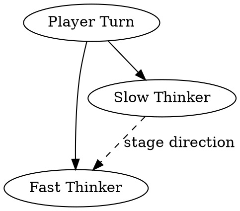

# Internal Wiki — Design

**Status:** Brainstormed, awaiting user review. Phase 1 (scaffolding) and Phase 2 (backfill) to follow as separate implementation plans.

## Goal

An agent-maintained, as-built visualization of the **whole Mythrun system** — both the application code and the AWS infrastructure. Purpose: give the sole human reader (Miklos) a fast-to-scan, diagram-heavy picture of what actually exists, so he doesn't have to keep up by reading every code diff, every Terraform change, and every AWS console tab. As the system evolves, the wiki evolves with it.

Infra coverage is at least as important as code coverage. AWS resources are inherently harder to visualize — they live across accounts, regions, modules, and environments, connected by references buried in HCL. The wiki exists largely to collapse that mess into something readable at a glance.

The wiki is for the reader, not the writer. Agents are the sole authors and editors; legibility and grep-friendliness for agents govern every technical decision.

## Non-goals

- Not a public docs site. Single-reader. No SEO, no analytics, no versioning across releases.
- Not a spec mirror. Specs live in `docs/specs/`. The wiki documents what is *built*, not what is *planned*. If a spec'd component isn't shipped yet, it doesn't appear in the wiki at all.
- Not a blog or activity feed. Not a ticket mirror. Linear stays in Linear, beads stay in beads.
- No brand section, no voice/style pages. `docs/wiki/BRAND.md` is author-side guidance, not a rendered page.
- Not a replacement for the AWS console or `terraform plan`. The wiki is a stable mental model of the infra shape, not a live inventory.

## Sources of truth

The wiki is derived from, and must stay consistent with, these sources:

| Source | What it drives |
|--------|----------------|
| Application code (`backend/`, future packages) | Runtime, Data, World/Campaign, Combat, Frontend section content |
| Terraform (`infra/environments/*`, `infra/modules/*`) | All Infra section content — modules, environments, resources, relationships |
| Bootstrap scripts (`infra/scripts/*`) | Ops procedures pages under Infra |
| External-service configs referenced but not in repo (Cognito pools, Stripe products, OAuth apps, domain registrar) | Named and linked from the appropriate pages; the wiki describes the *integration*, not the console state |
| Git history on the above files | `last-updated` timestamps per page |

If a fact about the system can't be sourced from one of the above, it doesn't belong on a wiki page. No folklore, no tribal knowledge, no "I think it works like this."

## Locked decisions

| Axis | Choice |
|------|--------|
| Scope | As-built only. Every page reflects code that exists in `main`. |
| Update cadence | Per Linear issue close. Wiki-update subagent dispatched by hook. |
| Diagram style | DOT / GraphViz → inline SVG. Workhorse. No hand-authored SVG. No pixel-art. |
| Page layout | Three-column: left section sidebar, content, right on-this-page TOC. |
| Nav shape | Two-tier scoped: top tabs switch sections; sidebar shows only current section's pages. |
| Build | Owned TypeScript script (`build.ts`), ~300 lines. No framework. |
| Output | Committed HTML in `docs/wiki/site/`. Openable via `file://`. No dev server required. |
| Author language | HTML fragments (no Markdown). Direct control over structure, zero rendering ambiguity. |
| Nav source of truth | `docs/wiki/structure.ts` (typed). Single file, build fails loudly on mismatch with `content/`. |

## Top-level sections (v1)

Seven top-tab sections. Infra is the largest because the real value of the wiki is there — AWS resources are inherently harder to hold in your head than code.

1. **Infra** — AWS account topology, Terraform module structure, environments, networking, compute plane, data plane, DNS, secrets, IAM/OIDC, CI/CD, observability, cost controls, bootstrap procedures. The dense section.
2. **Runtime** — session loop, Fast Thinker, Slow Thinker, Scribe, DM Trigger, prompts, cost budgets, Anthropic integration.
3. **Data** — schemas, repositories, Postgres, Redis, BullMQ, migrations.
4. **Auth & Billing** — Cognito integration, JWT handling, invites, Stripe integration, credits.
5. **World & Campaign** — prep engine, world store, campaign pipeline.
6. **Combat** — rules engine, voxel maps, map rendering.
7. **Frontend** — components, Three.js layer, design system adapters.

External-service integrations (Anthropic, Stripe, Cognito, OAuth providers, SES) do not get their own top section. Each is documented under the functional section that uses it — Anthropic under Runtime, Stripe and Cognito under Auth & Billing, SES under Infra/DNS. The page describes the *integration and contract*, not the vendor's console state.

Sections are declared in `structure.ts`. Adding a new section is an edit there plus a new `content/<section>/index.html`.

### Infra section page set (illustrative, Phase 2 target)

Because Infra is the deepest, here's the page shape it should reach by end of Phase 2. This is informed by the current `infra/` layout (modules: `data`, `dns`, `network`, `serving`; environments: `shared`, `staging`).

- `index` — Overview: a single master diagram of the account(s), environments, and how modules compose into each environment. Text summary of the infra philosophy.
- `account-topology` — AWS accounts in play, what lives in each, how SSO/access is structured.
- `environments/shared` — what's in the `shared` workspace; remote-state producer for downstream envs.
- `environments/staging` — what `staging` actually deploys; how it pulls from `shared`; module bindings.
- `modules/network` — VPC, subnets (public/private), routing, NAT, security groups. DOT diagram.
- `modules/data` — RDS, ElastiCache, subnet groups, parameter groups. DOT diagram of data-plane wiring.
- `modules/serving` — ECS cluster, services, task definitions, ALB, target groups, listener rules, health checks. DOT diagram of request path.
- `modules/dns` — Route53 zones, records, SES domain/DKIM, email sending identity.
- `ci-cd` — GitHub Actions OIDC trust, role structure, what each workflow can do, deploy boundaries.
- `secrets` — Secrets Manager entries, which are manual vs bootstrap-populated, how the app consumes them.
- `observability` — SNS topics, subscriber endpoints, CloudWatch alarms, metric flows.
- `bootstrap` — what `bootstrap.sh` and `bootstrap-databases.sh` do, order-of-operations, when each is run.

These are targets for Phase 2; they are *not* pre-created at scaffold time. Phase 1 only creates `infra/index.html` as a placeholder.

## Repo layout

```
docs/wiki/
├── BRAND.md                    (already written; author-side brand reference)
├── AUTHORING.md                (how to write pages; wiki-update subagent prompt template lives here)
├── README.md                   (one-pager: build, serve, add a page)
├── structure.ts                (SOURCE OF TRUTH for sections, pages, order)
├── build.ts                    (build script, entry point)
├── build/                      (build helpers split from build.ts when needed)
│   ├── renderShell.ts
│   ├── renderDot.ts
│   ├── extractToc.ts
│   └── types.ts
├── assets/                     (already populated: logos, favicon)
│   ├── favicon.svg             (saturated info-blue #1A7DC4 — dev-tool color, not brand ink)
│   ├── lockup-horizontal-primary.svg
│   ├── lockup-horizontal-reverse.svg
│   ├── lockup-stacked-primary.svg
│   ├── mark-ink.svg
│   └── mark-primary.svg
├── layout/
│   ├── shell.html              (page frame with @slot markers)
│   ├── styles.css              (brand CSS — paper palette, three fonts, three-column grid)
│   ├── helper.js               (client-side: TOC scrollspy, active-nav highlight)
│   └── dot-header.dot          (shared DOT prelude applied to every diagram for brand consistency)
├── content/                    (one file per page, article body only)
│   ├── index.html              (landing page)
│   ├── infra/
│   │   └── index.html          (section overview — starts as "nothing built here yet")
│   ├── runtime/
│   │   └── index.html
│   ├── data/
│   │   └── index.html
│   ├── auth-billing/
│   │   └── index.html
│   ├── world-campaign/
│   │   └── index.html
│   ├── combat/
│   │   └── index.html
│   └── frontend/
│       └── index.html
├── diagrams/                   (DOT source files, mirror content/ tree)
│   └── (empty at scaffold time)
└── site/                       (BUILD OUTPUT, committed to git)
    ├── index.html
    ├── runtime/index.html
    ├── data/index.html
    ├── (and so on)
    ├── assets/                 (copied from ../assets on build)
    ├── styles.css              (copied from ../layout)
    ├── helper.js               (copied from ../layout)
    └── diagrams/               (rendered SVGs, mirrors ../diagrams tree)
```

## `structure.ts` — schema and example

```ts
export interface Page {
  slug: string         // file slug; 'fast-thinker' → content/runtime/fast-thinker.html → site/runtime/fast-thinker.html
  title: string        // rendered in sidebar and browser tab
}

export interface Section {
  slug: string         // url segment; 'runtime' → site/runtime/
  title: string        // rendered in top-tab nav
  pages: Page[]        // first page must be { slug: 'index', title: 'Overview' }
}

export const structure: Section[] = [
  {
    slug: 'infra',
    title: 'Infra',
    pages: [
      { slug: 'index', title: 'Overview' },
    ],
  },
  {
    slug: 'runtime',
    title: 'Runtime',
    pages: [
      { slug: 'index', title: 'Overview' },
    ],
  },
  {
    slug: 'data',
    title: 'Data',
    pages: [
      { slug: 'index', title: 'Overview' },
    ],
  },
  {
    slug: 'auth-billing',
    title: 'Auth & Billing',
    pages: [
      { slug: 'index', title: 'Overview' },
    ],
  },
  {
    slug: 'world-campaign',
    title: 'World & Campaign',
    pages: [
      { slug: 'index', title: 'Overview' },
    ],
  },
  {
    slug: 'combat',
    title: 'Combat',
    pages: [
      { slug: 'index', title: 'Overview' },
    ],
  },
  {
    slug: 'frontend',
    title: 'Frontend',
    pages: [
      { slug: 'index', title: 'Overview' },
    ],
  },
]
```

Rules:
- Every section's `pages[0]` is its index page (`slug: 'index'`, `title: 'Overview'`).
- Slugs are kebab-case, URL-safe. No nested subsections (flat under each section).
- Build fails with a non-zero exit and a listing of mismatches if:
  - `content/<section>/<page>.html` exists but isn't in `structure.ts`, or
  - A page is in `structure.ts` but the content file is missing, or
  - Two sections or two pages share a slug.

## Content file format

Each `content/<section>/<page>.html` is an HTML fragment — article body only, no `<html>` / `<head>` / `<body>`. Every page that documents source material declares which files or directories it derives from (see Drift detection, below). Example:

```html
<!-- source: backend/src/runtime/fast-thinker/ -->
<!-- source: backend/prompts/fast-thinker/ -->
<!-- source-hash: sha256:8f3ca12b...a20b -->
<!-- last-ticket: MYT-014 -->

<h1>Fast Thinker</h1>

<p class="lead">
  The Fast Thinker handles player-facing prose generation. It operates under
  enforced ignorance — no plot knowledge, no NPC secrets.
</p>

<!-- @diagram: runtime/fast-thinker-flow -->

<h2>Inputs</h2>
<p>Scene context, player action, stage direction from Slow Thinker (when present).</p>

<h2>Outputs</h2>
<p>Prose string, emitted to the session log.</p>

<h2>Source</h2>
<p>
  Implementation: <code>backend/src/runtime/fast-thinker/</code>.
  Prompt templates: <code>backend/prompts/fast-thinker/</code>.
</p>
```

Conventions:
- First `<h1>` drives the page title (browser tab, crumbs, and sidebar entry cross-checked against `structure.ts`).
- `<h2>` and `<h3>` are auto-collected into the right-column on-this-page TOC.
- `<!-- @diagram: <section>/<name> -->` inlines the rendered SVG from `diagrams/<section>/<name>.dot`. Self-closing; no fallback text.
- `<!-- source: <path> -->` comments at the top declare tracked source paths. One comment per path. Paths are relative to repo root. See Drift detection.
- `<!-- source-hash: sha256:... -->` — auto-maintained by the build on `--accept-drift`. Agents and authors do not edit this by hand.
- `<!-- last-ticket: MYT-### -->` — the Linear issue that most recently caused the page to be updated. Useful for the wiki-update subagent on future edits.
- `<p class="lead">` for the one-paragraph summary directly under the title. Styled slightly larger in CSS.
- `<code>` for inline code spans. `<pre><code>...</code></pre>` for blocks; CSS targets both.
- No frontmatter. Non-source meta (last-updated timestamp, shipping status if we ever add it) is derived at build time from git or from `structure.ts`, not embedded in content files.
- Pages that document no source (landing page, section overviews) omit the `source` and `source-hash` comments entirely. The build skips drift checks on such pages.

## Authoring guidance for infra pages

Infra pages have tighter conventions than code pages because the mental model is the whole point.

**Every module page contains:**
- One-paragraph summary: what this module creates, why it exists.
- **Inputs** — table of variables with type and purpose. Source: `variables.tf`.
- **Outputs** — table of outputs with what consumes them. Source: `outputs.tf`.
- **Resources** — list of AWS resources created, grouped by type (compute / data / network / IAM / etc.). Source: `main.tf`.
- **Diagram** — DOT diagram showing the resources created and their relationships (security-group references, IAM attachments, target-group registrations, whatever is relevant). Use subgraphs to group by resource type where it helps.
- **Consumers** — which environments invoke this module, with anchored links to those environment pages.
- **Source path** — `<code>infra/modules/&lt;name&gt;/</code>`.

**Every environment page contains:**
- What this environment is for (shared foundation, staging, prod when it exists).
- AWS account it targets. Region(s).
- Remote-state dependencies — which other environments' outputs it reads.
- Module bindings — each `module "foo" { source = "../../modules/foo" }` with the values it's bound to.
- **Diagram** — the composed view: modules as subgraphs, wiring between them, external service endpoints (Secrets Manager entries referenced, Route53 zones referenced, etc.).
- Source path — `<code>infra/environments/&lt;name&gt;/</code>`.

**Terraform-parsing policy for the authoring agent:**

Per Zero Framework Cognition, there is no automated HCL parser in the wiki build. The wiki-update subagent *reads* the Terraform files directly, understands them, and authors the DOT diagrams and resource tables by hand. This is the right call because:

- Understanding what a diagram should *show* (the story) vs. what the code *does* (all of it) is a judgment call — we want the agent making it, not a tool.
- `terraform graph` exists and produces DOT, but its output is too dense (every resource, every implicit dep) to be readable without significant post-processing. Can be consulted as a reference when authoring but not inlined.
- HCL-to-JSON converters (`@cdktf/hcl2json` etc.) add a dependency for a problem the agent can solve by reading.

The subagent prompt template in `AUTHORING.md` instructs: "Read the Terraform files in scope. Identify the resources and the relationships that matter for the reader's mental model. Draw a diagram that shows those, omitting noise (per-resource tags, redundant IAM details, default-value outputs). Err toward clarity over completeness."

## Diagram authoring

DOT files live at `diagrams/<section>/<name>.dot`. Example:



`layout/dot-header.dot` sets graph/node/edge defaults so every diagram looks consistent without per-file repetition:

```dot
// Prepended to every diagram at build time.
graph [
  bgcolor="#EFE9DC",
  fontname="IBM Plex Mono",
  fontsize=11,
  rankdir=LR,
  margin=0.2,
]
node [
  shape=box,
  style="filled",
  fillcolor="#EFE9DC",
  color="#231B12",
  fontcolor="#231B12",
  fontname="IBM Plex Mono",
  fontsize=11,
  penwidth=1.5,
]
edge [
  color="#231B12",
  fontname="IBM Plex Mono",
  fontsize=10,
  penwidth=1.2,
  arrowsize=0.7,
]
// Color aliases used in content DOT files:
//   "ember" is aliased to #8A5A3C in renderDot post-processing (simpler than DOT colorscheme).
```

Build step (`build/renderDot.ts`): concatenate header + content DOT, substitute `"ember"` → `"#8A5A3C"`, render via `@hpcc-js/wasm` Graphviz (WASM; zero native install), write SVG to `site/diagrams/<section>/<name>.svg`. The SVG is also inlined directly at its `<!-- @diagram: -->` marker so content and diagram render as a single HTML document.

## Drift detection

The cadence-based update mechanism (subagent fires on Linear issue close) is our best signal that the wiki stays current, but it isn't airtight. Three failure modes could leave the wiki silently stale:

1. A source change lands without an associated Linear issue (a direct commit to `main`, a hotfix).
2. The PostToolUse hook fails, or the subagent makes a judgment call and misses an affected page.
3. Source drifts cosmetically (variable renames, default-value tweaks) and the wiki's prose becomes subtly wrong without anyone noticing.

Drift detection is the safety net. Every page that documents source declares its tracked paths, the build computes and verifies a content-hash of those paths, and both the rendered HTML and the CI pipeline surface mismatches loudly.

**Per-page source declarations.** Page-top comments:
- `<!-- source: <path> -->` — one per tracked path. Path is relative to repo root, points to a file or directory. Recursive for directories.
- `<!-- source-hash: sha256:... -->` — auto-maintained by the build. Agents do not edit this by hand.

**Hash algorithm.** Deterministic and simple:
1. For each declared path, enumerate all files recursively (directories) or just the file (file paths).
2. Sort the resulting file list by path.
3. For each file, compute `sha256(path + "\x00" + file-bytes)`.
4. Concatenate all per-file hashes, sha256 the result. That's the page's source-hash.

Paths that don't exist on disk cause the build to fail loudly, naming the page and the missing path. This catches "module was deleted but page wasn't."

**Build-time behavior.**

- `pnpm wiki:build` (default, permissive):
  - For each page with declared sources, compute current hash.
  - If current hash matches embedded hash, render page normally. No drift badge.
  - If current hash differs, render page with a visible drift banner at the top and log a warning to stdout. Build exits 0.
  - If a page has `source` but no `source-hash` (new page), render normally and print "NEW" in the build summary; agent must run `pnpm wiki:accept-drift <page>` to lock the hash before commit.

- `pnpm wiki:check` (CI-strict): runs the same hash comparisons but exits non-zero on any drift, missing hash, or missing source path. This is the merge gate.

- `pnpm wiki:accept-drift [page-path]` (explicit): rewrites the `source-hash` comment(s) to match current source state. Run by the wiki-update subagent after it has verified the page content reflects the new source. Without a page path, rewrites all drifted pages. Interactive confirmation (or `--yes` flag) recommended to prevent accidental mass-accept.

**Rendered drift banner.**

Injected at the top of the `<article>` in the rendered HTML when the page has drift:

```html
<div class="wiki-drift-banner" role="alert">
  <strong>⚠️ Source has drifted.</strong>
  <span>The source files this page documents have changed since the page was last updated. Verify before trusting.</span>
  <code>source: infra/modules/network/</code>
</div>
```

Styled in `layout/styles.css`: `paper-100` background, `danger-500` (`#B55A48`) left border, `paper-900` text, mono code snippet. Persistent — sticks to the top of the article, not dismissible. The only red thing in the entire wiki.

**Subagent flow.** The wiki-update subagent's terminal steps, per `AUTHORING.md`:

1. Edit content files and DOT sources per the Linear issue's scope.
2. Run `pnpm wiki:build`. Inspect the drift warnings.
3. For every drifted page touched by this update, verify the content reflects the new source. If yes, run `pnpm wiki:accept-drift <page>`. If no, fix the content and loop.
4. Run `pnpm wiki:check`. Must exit 0.
5. Commit.

**Edge cases.**

- **Cosmetic-only source change** (e.g., tag update in a Terraform module): triggers drift. The subagent reviews, confirms the page's architectural description is still accurate, runs `--accept-drift` without content changes. One commit per cycle; small but worthwhile friction.
- **Source file moved/renamed**: the page's `<!-- source: -->` path becomes invalid → build fails. The subagent updates the path declaration and re-hashes.
- **Page documents multiple sources, only one drifts**: drift is page-level, not path-level. One drifted path triggers the whole page's banner. Simpler than path-level granularity, and in practice if one path drifted the page probably needs review anyway.

## `layout/shell.html`

A single file with distinctive slot tokens. Build does plain string substitution — no templating library.

```html
<!DOCTYPE html>
<html lang="en">
<head>
  <meta charset="UTF-8">
  <meta name="viewport" content="width=device-width, initial-scale=1">
  <title><!-- @pageTitle --> · Mythrun Wiki</title>
  <link rel="icon" type="image/svg+xml" href="<!-- @rootPath -->assets/favicon.svg">
  <link rel="preconnect" href="https://fonts.googleapis.com">
  <link rel="preconnect" href="https://fonts.gstatic.com" crossorigin>
  <link href="https://fonts.googleapis.com/css2?family=Source+Serif+4:ital,opsz,wght@0,8..60,300..900;1,8..60,300..900&family=IBM+Plex+Mono:wght@400;500;600&display=swap" rel="stylesheet">
  <link rel="stylesheet" href="<!-- @rootPath -->styles.css">
</head>
<body>
  <header class="wiki-header">
    <a href="<!-- @rootPath -->index.html" class="wiki-lockup">
      assets/lockup-horizontal-primary.svg" alt="Mythrun">
      <span class="wiki-label">wiki</span>
    </a>
    <nav class="wiki-topnav"><!-- @topnav --></nav>
  </header>

  <div class="wiki-shell">
    <aside class="wiki-sidebar"><!-- @sidebar --></aside>
    <main class="wiki-content">
      <div class="wiki-crumbs"><!-- @crumbs --></div>
      <article><!-- @content --></article>
      <footer class="wiki-page-footer"><!-- @lastUpdated --></footer>
    </main>
    <aside class="wiki-toc">
      <div class="wiki-toc-label">On this page</div>
      <!-- @toc -->
    </aside>
  </div>

  <script src="<!-- @rootPath -->helper.js"></script>
</body>
</html>
```

Slot markers (distinct, grep-friendly):
- `<!-- @pageTitle -->` — plain text, current page title
- `<!-- @rootPath -->` — relative prefix to wiki root (`""` for root page, `"../"` for section pages); keeps every page openable via `file://`
- `<!-- @topnav -->` — rendered top-tab nav HTML
- `<!-- @sidebar -->` — rendered section sidebar HTML (only the current section)
- `<!-- @crumbs -->` — `section › page` crumb trail
- `<!-- @content -->` — content fragment with diagram markers resolved
- `<!-- @toc -->` — on-this-page TOC, derived from `<h2>`/`<h3>` in content
- `<!-- @lastUpdated -->` — derived from `git log -1` on the content file (ISO date)

## `layout/styles.css`

Brand palette, three-column CSS grid, typographic scale, nav chrome styling. Single stylesheet, ~250 lines target.

Relevant tokens (via CSS custom properties at `:root`):
- `--paper-100: #EFE9DC` (bg)
- `--paper-300: #C9C0AD` (borders/dividers)
- `--paper-500: #877F72` (meta/captions)
- `--paper-700: #3D3528` (secondary text)
- `--paper-900: #231B12` (primary text)
- `--ember-600: #8A5A3C` (links, active nav, accent)
- `--serif: 'Source Serif 4', Georgia, serif`
- `--mono: 'IBM Plex Mono', ui-monospace, monospace`

Layout: CSS Grid with three tracks — `240px 1fr 200px` on wide screens; collapses to single column below 900px (on narrow screens, sidebar becomes a top drawer with a hamburger toggle; TOC becomes a floating button that expands). Narrow-screen behavior is deferred for v2; v1 assumes the reader is on a desktop.

## `layout/helper.js`

Client-side enhancements, tiny (~80 lines):
- **TOC scrollspy** — highlight the TOC item matching the currently-visible `<h2>`/`<h3>`. `IntersectionObserver`.
- **Active-nav highlight** — set on the current page's sidebar entry by matching `location.pathname` against rendered `data-slug` attributes. (Could be rendered at build time instead; client-side keeps the build stage simpler.)
- No SPA behavior. Every page is a full load.

## Build pipeline — `build.ts`

```
pnpm wiki:build
```

Steps, in order:
1. Load `structure.ts` (compiled via `tsx`).
2. Walk `content/`. Cross-check with `structure.ts`. Fail on mismatches.
3. Walk `diagrams/`. For each `.dot` file, prepend `layout/dot-header.dot`, substitute color aliases, render via `@hpcc-js/wasm` Graphviz. Cache on content-hash to make re-builds fast.
4. For each page: read content fragment, extract headings for TOC, substitute `<!-- @diagram: x/y -->` markers with the SVG (inlined, not ``), stitch into `shell.html` with computed sidebar/topnav/crumbs.
5. Copy `layout/styles.css`, `layout/helper.js`, and all of `assets/` into `site/`.
6. Copy rendered SVGs into `site/diagrams/` (so they're also reachable as files, even though inlined on pages).
7. Write `site/404.html` — a simple "page not found" with a link back to the index.
8. Print a summary: `built 12 pages, 3 diagrams, 0 errors` or similar.

Dependencies (added to root `package.json`):
- `@hpcc-js/wasm` — DOT → SVG renderer, WASM, self-contained
- `tsx` — to run `structure.ts` and `build.ts` without a compile step
- Everything else: Node built-ins (`fs`, `path`, `crypto`)

Package scripts (added to root `package.json`):
- `wiki:build` — `tsx docs/wiki/build.ts`
- `wiki:serve` — `tsx docs/wiki/build.ts && npx -y serve docs/wiki/site -l 8787` (optional nicety)

Determinism: same inputs → same outputs. No timestamps in generated HTML (last-updated comes from git, which is deterministic for a given commit). The build is idempotent; if nothing changed, `site/` is byte-identical to what was there before.

## Update mechanism — Claude Code hook

A `PostToolUse` hook on `mcp__linear-server__save_issue` inspects the tool input for `state` transitions into `Done`. When detected, it appends a `<system-reminder>` to the transcript directing the main agent to dispatch a wiki-update subagent immediately.

Hook contract:
- **Trigger:** `PostToolUse` on `mcp__linear-server__save_issue` with issue state transitioning to `Done`.
- **Action:** emit a system reminder naming the closed Linear issue ID and instructing the agent to dispatch a subagent of type `general-purpose` with model `opus` and the prompt template from `docs/wiki/AUTHORING.md` → "Wiki Update Subagent Prompt".

`docs/wiki/AUTHORING.md` contains:
1. **Human-facing authoring guide** — how to write content pages, file layout, diagram conventions, when to add a new page vs. edit an existing one.
2. **Wiki Update Subagent Prompt** — the template used by the hook-dispatched subagent. Parameterized with `{{linearIssueId}}`. The subagent reads the Linear issue, reads `git log` since the previous wiki commit for files touched by the issue, inspects the current state of those files, decides what pages to add or update, writes the content, updates `structure.ts` if needed, renders any new DOT diagrams, runs `pnpm wiki:build`, verifies the build succeeded, and commits with a message referencing the Linear issue.

The hook's shell implementation and the exact subagent prompt are detailed in Phase 1's implementation plan.

## CLAUDE.md update

Standard Implementation Workflow step 7 ("Close the loop") gets an addendum:

> When the Linear issue's status is flipped to Done via `mcp__linear-server__save_issue`, a `PostToolUse` hook will inject a reminder to dispatch the wiki-update subagent. Do not skip this. The subagent runs autonomously and commits the wiki updates in its own commit(s) before the session ends.

And a new Standing Rule:

> Wiki is not optional. Every Linear issue that ships code updates the wiki in the same session.

## Phase plan

**Phase 1 — Scaffolding.** Own plan at `docs/superpowers/plans/2026-04-23-wiki-scaffolding.md`. Delivers:
- `structure.ts` with all seven sections, each with an `index` page only
- `build.ts` + `build/*.ts` helpers (renderShell, renderDot, extractToc, sourceHash, types)
- `layout/shell.html`, `layout/styles.css` (including drift-banner styles), `layout/helper.js`, `layout/dot-header.dot`
- `content/index.html` (landing page)
- `content/<section>/index.html` × 7 (each "nothing built here yet"; no source declarations since these are sourceless)
- `AUTHORING.md` (authoring guide + wiki-update subagent prompt template including the drift-accept workflow)
- `README.md` (one-pager)
- Claude Code hook on `mcp__linear-server__save_issue` with supporting shell script
- `CLAUDE.md` updated with workflow addendum
- `site/` built, committed, openable from `file://` (favicon renders as dev-tool blue `#1A7DC4`, visually distinct from any future Mythrun product tab)
- Package.json dependencies (`@hpcc-js/wasm`, `tsx`) + scripts (`wiki:build`, `wiki:check`, `wiki:accept-drift`, optional `wiki:serve`)
- One smoke-test DOT diagram on the landing page (a "map of the wiki" overview showing the seven sections) to prove the pipeline renders end-to-end; section index pages remain "nothing built here yet" until Phase 2. The Infra landing page gets a one-line note that this section is where AWS and Terraform structure will be documented.
- One smoke-test page with a fake `<!-- source: -->` declaration and a deliberately-drifted hash to prove the drift banner + CI gate both fire, removed before commit
- CI workflow addition: `pnpm wiki:check` in the pull-request pipeline
- `.gitignore` sanity check (site/ is committed, but not caches)

Exit criteria: open `docs/wiki/site/index.html` locally; nav across all seven sections works; right TOC renders on pages that have `<h2>` headings; smoke-test DOT diagram renders on-brand; `pnpm wiki:build` is idempotent; `pnpm wiki:check` exits 0 on a clean tree; drift banner renders correctly when a source file is touched without accepting drift; CI fails the build when wiki is drifted.

**Phase 2 — Backfill.** Own plan at `docs/superpowers/plans/YYYY-MM-DD-wiki-backfill.md` (dated when phase 1 is done). Delivers:
- Audit of every closed Linear issue (code commits + Terraform commits) and the current state of the repo
- **Infra coverage first** — module pages, environment pages, CI/CD, secrets, observability, bootstrap procedures. This is the highest-leverage payoff.
- Code coverage second — Runtime, Data, and other sections for whatever has shipped
- DOT diagrams wherever architecture is non-trivial
- `structure.ts` populated with all real pages
- Each page tied back to its source Linear issue ID in a `<!-- last-ticket: MYT-### -->` comment (for the wiki-update subagent's benefit on future edits)
- Page headers include source paths (`<code>infra/modules/network/</code>`, `<code>backend/src/...</code>`) so a reader can jump to the code

Exit criteria: wiki matches `main` as of the phase-2 commit, with the Infra section fully populated against the current `infra/` tree and every shipped application component documented.

## Open questions (deferred, not blockers)

- **Search.** Not in v1. If needed, a tiny client-side index (`lunr` or a hand-written trigram index over content files) can be added without touching the build shape.
- **Status badges.** ("shipped," "in-progress," "deprecated") — not needed for as-built-only, but could be useful if we ever track refactors-in-progress on existing pages. Deferred.
- **Narrow-screen layout.** Deferred to v2. Desktop-first is fine for a single-reader wiki.
- **Diagram caching heuristic.** Hash-based caching is simple and correct; if build time becomes a pain, revisit.
- **Cross-page links.** Agents author `<a href="../runtime/fast-thinker.html">` directly. No shortcut syntax. If this becomes painful, a `<!-- @link: runtime/fast-thinker -->` token can be added later.
- **`terraform graph` as escape-hatch diagram.** Ruled out for routine use (it dumps the full internal dependency DAG with every provider node, module-expansion node, and implicit reference, producing an unreadable tangle for anything non-trivial; it also requires `terraform init` to have been run, pulling provider binaries). Kept as an optional tool if a particular module page ever wants a collapsible "full dependency graph" detail — the agent would run it offline, manually clean the output, and embed the resulting SVG. Not automated.
- **Terraform state awareness.** The wiki is derived from Terraform *source*, not state. A resource that's been `terraform apply`'d out of existence but whose module code still exists will still appear in the wiki. That's the right default (source is truth), but worth naming. If we ever want state-awareness, it would be a separate "live inventory" tool, not a wiki concern.
- **Drift-banner noise tolerance.** If cosmetic changes (like Terraform `tags` updates) trigger the banner too often and the signal erodes, we may refine to per-path or per-hunk diffing. Not pre-optimizing; revisit if it becomes a pain in practice.

## Out of scope

- Any flavor of server-side rendering, dynamic content, or authentication.
- Syncing with external tools (Notion, Confluence, etc.).
- Markdown authoring.
- A framework (Astro, 11ty, Docusaurus, mkdocs, Docsify, Next.js, etc.).
- Dark mode, theme switcher, user preferences.
- Multi-language support.
